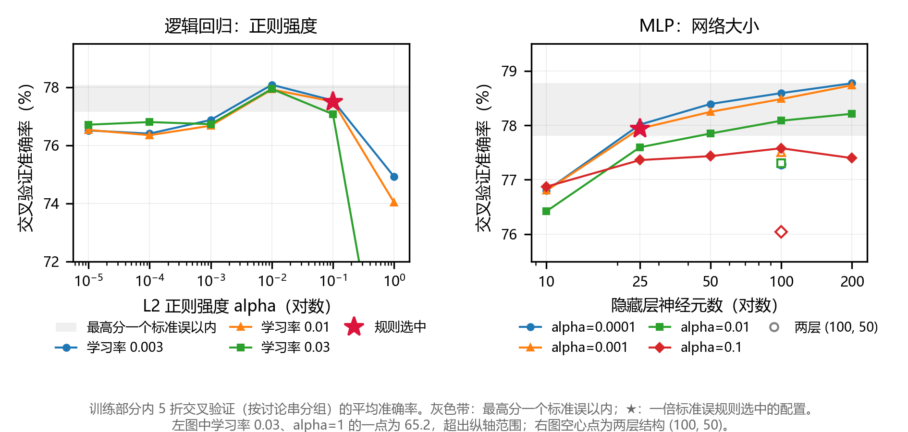
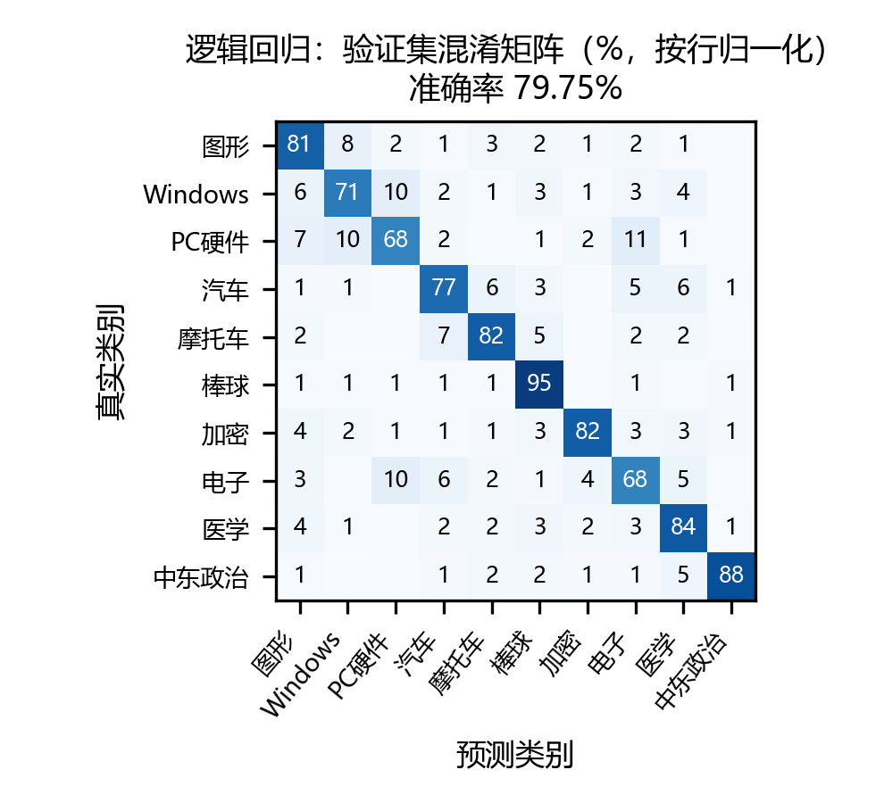
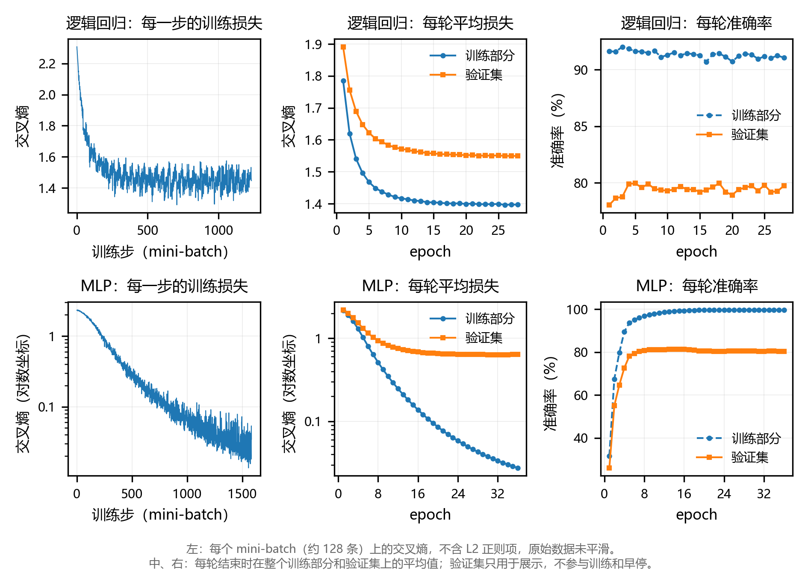
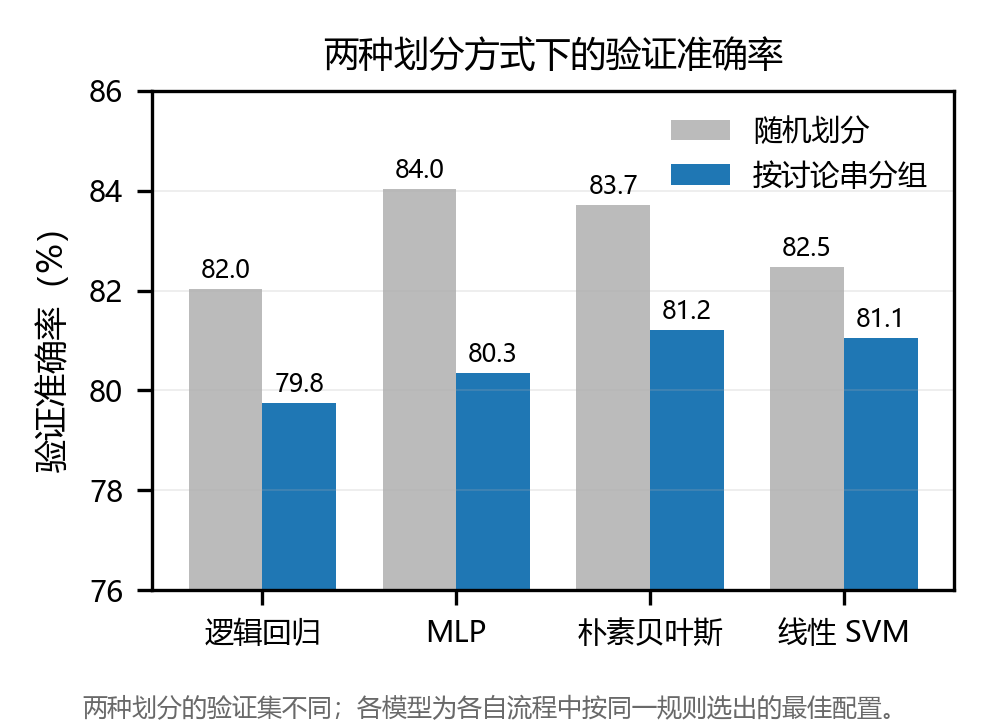

# 实验一：新闻文本分类

当代人工智能实验课 · 实验一。对 20 Newsgroups 中 10 个类别的英文新闻组帖子进行分类：TF-IDF 特征，主力模型为逻辑回归和 MLP，朴素贝叶斯和线性 SVM 作对照。

## 结论

| 项 | 结果 |
|---|---|
| 最终模型 | **逻辑回归**（softmax + 交叉熵）：L2 正则 alpha=0.1，Adam 学习率 0.01，训练 28 轮 |
| 特征 | TF-IDF：单词 + 二元词组，`min_df=5`，`sublinear_tf=True`，英文停用词表，词表 14,540 |
| 输入 | 只用帖子**正文**，删除头部（含标题）、引用、签名等 |
| 交叉验证（训练部分 5 折，按讨论串分组） | 77.51 ± 2.69 |
| **验证集准确率** | **79.75%**（macro-F1 79.74%） |
| 提交文件 | `outputs/predictions_final.csv`（2457 行、单列、无表头） |

---

## 目录结构

```
├── preprocess.py            数据加载、按讨论串分组划分、文本清洗、清洗检查报告
├── train.py                 交叉验证调参 + 验证集比较 + 损失曲线
├── predict.py               用最终模型预测测试集，并核对提交格式
├── environment.yml          运行环境（固定版本）
├── splits/                  固定的训练/验证划分下标
├── experiments/
│   ├── explore_train_only.py     数据摸底（只用训练部分）
│   ├── preprocess_ablation.py    预处理方法消融
│   ├── leakage_audit.py          泄露审计
│   └── report_figures.py         报告用图
├── outputs/                 全部结果、日志和图
├── draft_main.py, TUNING.md, predictions.csv   助教提供的文件（未修改）
└── train_data.csv, test_data_unlabeled.csv     数据
```

## 运行

```bash
conda env create -f environment.yml
conda activate project1
python preprocess.py      # 约 1 分钟：划分 + 清洗检查报告
python train.py           # 约 31 分钟（16 线程 CPU）：调参 + 验证集比较 + 画图
python predict.py         # 约 1 分钟：预测测试集 + 核对格式
```

脚本按自身所在位置寻找数据，不依赖绝对路径。`python train.py --stage 2` 只做验证集比较和画图，不重新调参。补充实验（报告中引用的数字由它们得出）：

```bash
python experiments/explore_train_only.py
python experiments/preprocess_ablation.py
python experiments/leakage_audit.py
python experiments/report_figures.py
```

---

## 实验流程

```
① 划分 → ② 预处理 → ③ 特征 → ④ 调参 → ⑤ 选模型 → ⑥ 测试一次
```

| 步骤 | 做法 | 用到的数据 |
|---|---|---|
| ① 划分 | 按讨论串分组 + 分层，约 75/25 | 训练数据 |
| ② 预处理 | 逐条文本的清洗规则，不学习任何统计量 | 规则依据只来自训练部分 |
| ③ 特征 | TF-IDF | 只在训练部分上 fit |
| ④ 调参 | 5 折交叉验证（分层，按讨论串分组） | 只用训练部分 |
| ⑤ 选模型 | 各族最佳配置在训练部分上训练，在验证集上比较 | 验证集只评估，不参与拟合和早停 |
| ⑥ 测试 | 最终模型对测试集预测一次 | 测试集只用这一次 |

---

## 1. 数据与划分

| 项 | 值 |
|---|---|
| 训练集 | 7368 条，10 类，每类 705～747 条 |
| 测试集 | 2457 条，无标签 |
| 讨论串 | 7368 条帖子分属 3535 个讨论串，最大的有 65 条 |

数据集没有提供验证集，需要自己划分。**划分按讨论串分组**：讨论串由标题去掉 `Re:`/`Fwd:` 前缀、统一小写后确定（只用于分组，不作为特征），同一讨论串的帖子只会整体落在训练部分或验证集。

- **为什么分组**：同一讨论串的帖子话题相同、参与者重叠。随机划分时同一讨论串会同时出现在训练和验证中，验证分数偏高。实测（训练部分内，只用正文，线性 SVM）：随机划分 83.46%，按讨论串分组 78.65%。PDF 也要求存在群组依赖时分组划分
- **实现**：`StratifiedGroupKFold(4, shuffle=False)` 取第 0 折。打乱会破坏它的分层（各类验证占比偏离 25% 达 8～13 个点），不打乱时偏离 ≤ 0.1 个点
- **结果**：训练 5526 条 / 验证 1842 条，**没有讨论串跨两边**，各类验证占比 24.9%～25.1%
- **比例 75/25**：比例实验中，验证集从 20% 增加到 25%，平均准确率只低 0.2 个点，种子间波动从 0.94 降到 0.48

---

## 2. 预处理

### 只用正文

帖子由**头部**（发件人、单位、标题、服务器……）和**正文**组成。只用头部里的单位和发件人邮箱域名做分类，交叉验证准确率就有 **44.2%**（随机猜是 10%）：模型不读正文就能猜对近一半，头部是严重的泄露源。

标题也删除。只用标题时，随机划分下准确率 83.55%，换成全新讨论串只有 62.74%：标题很大程度上在充当"讨论串编号"。另外 67.2% 的标题以 `Re:` 开头，是从原帖继承的。

### 清洗规则

每条规则都只在训练部分上找依据，并逐条抽查"删掉了什么"：

| 规则 | 做法 | 依据 |
|---|---|---|
| ① 去头部 | 以第一个只含空白的行切分，删除头部；正文开头的内层头部一并剥离 | 头部泄露 44.2%；有的分隔行含空格，按严格空行会切错 |
| ② 去引用 | 删 `>`、`\|>` 开头的行；单独的 `\|` 不删 | 引用的是别人的帖子；182 个帖子用单独的 `\|` 画表格 |
| ③ 去引述行 | 删 "xxx writes/wrote/says:" | 含人名和邮箱 |
| ④ 去签名 | 只认标准 `--` 分隔行，其后不超过 15 行且截断后正文不为空 | 签名是姓名、单位；126 个帖子在长横线后接正文，不能当签名删 |
| ⑤ 去乱码 | 只删 uuencode 编码块，尾行做长度校验 | 按"字母占比低"删会误删 1619 个帖子的真实内容（如棒球积分榜） |
| ⑥ 删邮箱、网址 | 删除 | 邮箱会拆出 `edu`、`com` 等噪声词 |
| 保留数字 | 不删 | 486/386 → PC 硬件，1914/1920 → 中东政治，有区分度 |

规则审计共发现并修正了 6 处误删或漏删，例如最初按"字母占比低"删乱码，会把棒球积分榜当乱码删掉。**这些问题光看统计数字发现不了，必须看实际删掉了什么。** 清洗后训练部分没有删除任何样本，保留 56.6% 的字符；11 条帖子正文为空（原帖没写正文或只有引用），保留不删。检查报告见 `outputs/cleaning_report.txt`。

### PDF 列出的四种预处理方法（消融）

训练部分内 5 折分组交叉验证，每次只改一项。判定规则事先确定：**差值的均值小于其标准差，视为没有可靠差别，选更简单的方案**。

| 方法 | 线性 SVM | 朴素贝叶斯 | 决策 |
|---|---|---|---|
| 去除正文以外的信息 | −10.70 ± 1.83（0/5 折更好） | −8.47 ± 2.47（0/5） | ✅ 采用（降掉的是靠泄露拿到的分数） |
| 去除标点 | +0.69 ± 0.41（5/5） | +0.00 ± 0.24（2/5） | ✅ 采用 |
| 去除停用词 | +0.63 ± 0.56（4/5） | +0.38 ± 0.36（4/5） | ✅ 采用（刚好超过波动） |
| 词干化 | +0.07 ± 1.03（4/5） | +0.51 ± 0.82（4/5） | ❌ 不采用 |

| 配置 | 线性 SVM | 朴素贝叶斯 |
|---|---|---|
| 原始文本（不清洗） | 89.34 ± 1.53 | 88.07 ± 1.48 |
| 只用正文 | 78.65 ± 2.35 | 79.60 ± 3.28 |
| **只用正文 + 去停用词（采用）** | **79.28 ± 2.28** | **79.98 ± 3.35** |

---

## 3. 特征与模型

| 模型 | 角色 | 实现 |
|---|---|---|
| 逻辑回归 | 主力 | 不带隐藏层的 `MLPClassifier(hidden_layer_sizes=())`，即多分类逻辑回归 |
| MLP | 主力 | `MLPClassifier`，ReLU，Adam |
| 朴素贝叶斯 | 对照 | `MultinomialNB` |
| 线性 SVM | 对照 | `LinearSVC` |

逻辑回归用 MLP 实现，是为了和 MLP 共用同一个手写训练循环（`train.py` 的 `train_iterative`），从而都能记录**每一步的损失**。朴素贝叶斯是闭式解，`LinearSVC` 不暴露迭代过程，二者没有逐步损失，只作对照。

训练循环：每轮打乱数据，**均匀分成约 128 条一批**，每批调用一次 `partial_fit`。如果按"每批 128 条、余数单独成一批"切，最后一批很小，sklearn 的 L2 项按批大小归一化，这一步的正则会被放大数倍，损失曲线每轮末尾出现尖刺。

---

## 4. 调参与模型选择

### 规则（调参前确定）

| 项 | 规定 |
|---|---|
| 评价指标 | 主要：准确率；辅助：macro-F1、各类别 F1、混淆矩阵 |
| 同一族内选配置 | **一倍标准误规则**：在交叉验证最高分一个标准误以内的配置中，选最简单的（正则更强、网络更小、词表更小） |
| 边界检查 | 自动检查选中的配置是否落在搜索范围边缘；如果落在边缘，说明范围不够，应扩展。最终 5 族全部在范围内部 |
| 早停 | 每折在留出折的交叉熵连续 3 轮不下降时停止，训练轮数取 5 折最佳轮数的中位数；验证集不参与 |
| 最终模型 | 在逻辑回归和 MLP 之间选：验证集准确率差的 bootstrap 95% 区间（**按讨论串整组抽样**）包含 0，就选更简单的逻辑回归 |
| 公平比较 | 同一族的所有配置使用相同的分折、相同的轮数上限、相同的早停规则 |

### 搜索范围与选择（全部结果见 `outputs/cv_results.csv`）

| 对象 | 搜索范围 | 选中 | 交叉验证 |
|---|---|---|---|
| TF-IDF | `min_df` {1,2,5,10} × 单词/加二元词组 × `sublinear_tf` 开/关（16 组） | `min_df=5`，加二元词组，`sublinear_tf` | 78.36 ± 2.26 |
| 逻辑回归 | alpha {1e-5…1} × 学习率 {0.003, 0.01, 0.03}（18 组） | alpha=0.1，学习率 0.01，28 轮 | 77.51 ± 2.69 |
| MLP | 结构 {(10,), (25,), (50,), (100,), (200,), (100,50)} × alpha {1e-4…0.1}（24 组） | (25,)，alpha=1e-3，36 轮 | 77.94 ± 2.11 |
| 朴素贝叶斯 | alpha {0.01, 0.1, 1, 10} | alpha=1 | 78.41 ± 2.65 |
| 线性 SVM | C {0.01, 0.1, 1, 10} | C=0.1 | 78.74 ± 2.49 |



- **正则强度有最优点**：逻辑回归在 alpha=0.01 时最高（78.09），太弱约 76.8，太强（alpha=1）降到 74.9
- **网络规模**：单层从 10 个神经元到 50 个提升明显（76.9 → 78.4），之后基本饱和；两层 (100, 50) 反而更差（77.5），而且第 6～8 轮就过拟合

### 验证集比较

| 模型 | 验证准确率 | macro-F1 |
|---|---|---|
| 朴素贝叶斯（对照） | 81.22 | 81.21 |
| 线性 SVM（对照） | 81.05 | 80.98 |
| MLP | 80.35 | 80.38 |
| **逻辑回归（最终）** | **79.75** | 79.74 |

- MLP − 逻辑回归 = +0.60，区间 [−1.13, +2.13] 包含 0 → 按规则选更简单的**逻辑回归**
- 对照模型在验证集上**显著更高**（朴素贝叶斯 +1.47，区间 [+0.05, +2.80]；SVM +1.30，区间 [+0.34, +2.31]）。最终模型的候选范围是事先定好的（只有逻辑回归和 MLP 能画逐步损失曲线），看到结果后再改标准属于"根据结果临时改变标准"，所以仍提交逻辑回归



错误集中在计算机/硬件类之间：PC 硬件有 11% 被判成电子，电子有 10% 被判成 PC 硬件，Windows 与 PC 硬件互相混淆约 10%。棒球（95%）和中东政治（88%）最容易分。

---

## 5. 损失曲线



- 左：每一步（一个 mini-batch）的交叉熵，**原始数据直接绘制，没有任何平滑**；中、右：每轮结束时在整个训练部分和验证集上的平均损失和准确率
- 三张图的损失口径一致，都是不含 L2 项的交叉熵（sklearn 的 `loss_` 含 L2 项，记录时扣除，已核对与直接计算的结果相差 ≤ 1e-15）
- 中图比左图平滑，是因为每个点是几千条样本上的平均值，不是做了平滑
- 真实性检查：第 1 步交叉熵约 2.31，接近 ln(10)=2.303（10 类平均猜测）；平稳段相邻两步涨跌反转的比例约 69%，与独立随机噪声的理论值 2/3 相近；按相同配置和种子重新训练可逐步复现
- 原始数值：`outputs/loss_logs/*_steps.csv`（每一步）、`*_epochs.csv`（每轮）

---

## 6. 主要发现

1. **按讨论串分组后，MLP 的优势消失**：随机划分时 MLP 比逻辑回归高 2.0 个点且显著；分组后只高 0.6，不显著。随机划分会高估复杂模型，它多出的能力主要用在记住同一讨论串的线索上
2. **简单的线性模型最好**：高维稀疏的 TF-IDF 特征下，朴素贝叶斯和线性 SVM 在验证集上最高
3. **一倍标准误规则在波动大时偏保守**：分组交叉验证的标准差约 2～3 个点，"一个标准误以内"的范围宽，规则倾向于选正则最强的配置（逻辑回归 alpha=0.01 时验证 80.67，规则选中的 alpha=0.1 为 79.75）
4. **过拟合**：MLP 训练准确率 99.7%、验证 80.4%；逻辑回归（强正则）训练 91.1%、验证 79.8%。加大正则能缩小差距，但不能提高验证准确率
5. **损失和准确率的最佳轮数不一致**：MLP 验证准确率在第 13 轮最高（81.38%），最终第 36 轮为 80.35%，而验证损失到最后才最低。继续训练让模型对已分对的样本更自信，同时把少数边界样本推错。早停标准事先定为损失，没有因此修改
6. **零点几个点的效果，换一种划分就可能改变结论**：去停用词在随机划分下没有可靠差别（SVM +0.45 ± 0.90），在分组划分下有小幅可靠提升（+0.63 ± 0.56）



---

## 7. 数据使用与实验规范

| 数据集 | 使用情况 |
|---|---|
| 训练部分 | 所有摸底、规则设计、调参、决策 |
| 验证集 | 只用于比较各族最佳配置，**从未参与拟合或早停** |
| 测试集 | 所有决策完成后预测一次，生成提交文件 |

**泄露审计**（`experiments/leakage_audit.py`）：训练部分与验证集重叠 0 条、跨两边的讨论串 0 个；TF-IDF 只在训练部分上 fit（词表 14,540，若加入验证集会变成 19,840）；调参代码不读验证集；清洗后的邮箱、引用行为 0。

**提交的模型就是验证过的模型**：`predict.py` 只用训练部分训练，先核对验证准确率与记录一致（79.75），再对测试集预测。测试集上各类别的预测条数为 210～295，"偏多预测 / 偏少预测"的倾向与验证集上一致（相关系数 0.95）。

**过程中修正过的问题**（如实记录）：

| 问题 | 修正 |
|---|---|
| 最初随机划分，理由是"测试集与训练集共享约一半讨论串"，这用到了测试集信息 | 改为按讨论串分组划分，测试集不再参与任何分析 |
| 每轮最后一批很小，损失曲线每轮末尾出现尖刺 | 改为均匀分批 |
| MLP 各组配置的轮数上限不一致（30/100），不满足公平比较 | 统一上限，一次运行完整网格 |
| 一倍标准误规则把选择推到搜索范围边缘 | 扩展范围，并加入自动边界检查 |
| 清洗规则最初在划分前设计 | 只用训练部分重新检验，得出相同规则 |

**可复现**：随机过程由 `preprocess.py` 的 `SEED=42` 控制（mini-batch 顺序、模型初始化、bootstrap）；划分和分折用不打乱的 `StratifiedGroupKFold`，结果是确定的；交叉验证 5 折并行，已验证与串行运行逐位一致；版本见 `environment.yml`。

---

## 8. 局限

- 只用了一个随机种子，没有评估模型初始化带来的波动；没有在干净环境中完整重跑
- 最终模型在验证集上比两个对照模型低约 1.3～1.5 个点（见第 4 节）
- 去停用词是在默认 TF-IDF 设置下决定的，没有在最终设置（`min_df=5`、加二元词组）下重新确认
- 引述跨两行时只删了第二行，5.1% 的训练帖子残留 "In article"，删掉后对准确率的影响在波动范围内
- 交叉验证中，逻辑回归和 MLP 的训练轮数在同一留出折上选择并打分，分数略偏乐观；模型间比较以验证集为准
- 固定未调：MLP 学习率、批大小、优化器、激活函数；sklearn 的 MLP 不支持 Dropout

---

## 输出文件

| 文件 | 内容 |
|---|---|
| `splits/split_val25_group.json` | 训练/验证下标 |
| `outputs/cleaning_report.txt` | 清洗检查报告（含被删内容抽样） |
| `outputs/cv_results.csv` | 每一组超参数的交叉验证结果 |
| `outputs/cv_selection.json`、`final_config.json` | 各族选中的配置、最终模型配置 |
| `outputs/val_results.json` | 验证集上的准确率、macro-F1、各类 F1、混淆矩阵、最终模型的选择依据 |
| `outputs/random_split_val_results.json` | 早期随机划分时各模型的验证结果（只用于图 4 对比） |
| `outputs/figures/` | 损失曲线、混淆矩阵；`report/` 为报告用图 |
| `outputs/loss_logs/` | 原始逐步损失与每轮损失 |
| `outputs/*_log.txt` | 各脚本的运行日志 |
| `outputs/run_info.json` | 运行环境、版本、种子、并行设置 |
| `outputs/predictions_final.csv` | **提交文件** |

`outputs/train_log.txt` 中有少量 joblib 清理临时文件时打印的 `KeyError` 报错，来自 Windows 下并行库的已知问题，不影响计算结果。

助教提供的 `draft_main.py`、`TUNING.md`、`predictions.csv`（格式样例）及数据文件保持原样，未修改。
