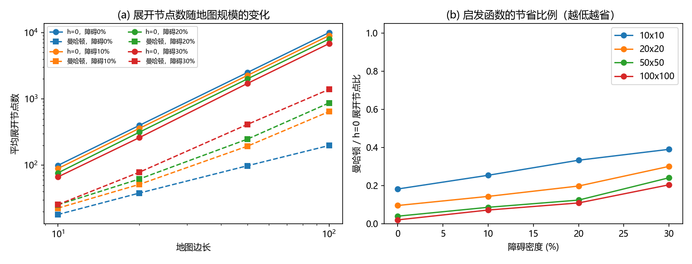
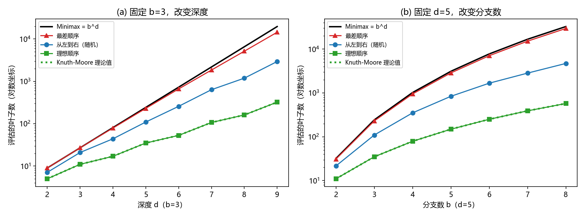
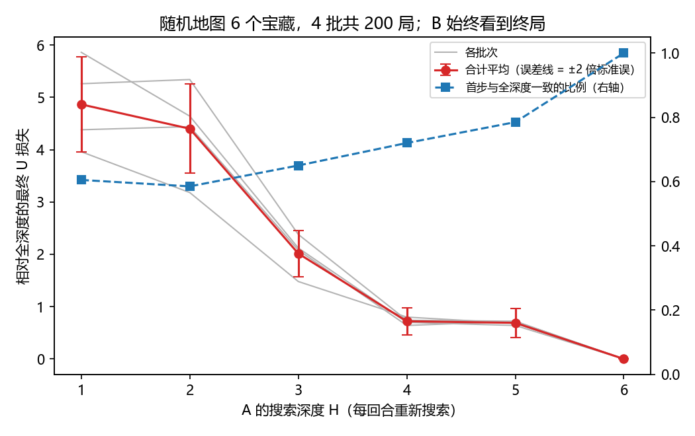

# 实验二：搜索算法


当代人工智能实验课 · 实验二。用 **A\*** 和 **Minimax / Alpha-Beta 剪枝**求解迷宫寻路、加权地形、博弈树和宝藏争夺四道题，并用对照实验解释启发函数、搜索深度与访问顺序如何影响搜索开销。

## 结论

| 题目 | 输出（均与预期一致） | 对照实验的主要发现 |
|---|---|---|
| 一、迷宫寻路 | `[(0,0),(0,1),(0,2),(1,2),(1,3),(1,4),(2,4),(3,4)]` | 100×100 无障碍地图上展开节点 9,999 → 198；障碍不超过 20% 时不存在 f < C\* 的节点，多余展开全部取决于平局规则 |
| 二、加权地形 | `7` | 普通曼哈顿距离不可采纳（样例 20/25 格高估），却在 6000 次求解中从未出错；高代价格子增多时 A\* 的优势呈渗流式骤降 |
| 三、Alpha-Beta | `5`（剪掉叶子 9） | 理想顺序的叶子数在 14 组参数上与 Knuth-Moore 公式完全一致；好顺序的关键是"剪得早"，而不是"剪得多" |
| 四、宝藏争夺 | H=2：`T2, -1`；H=4：`T3, 3` | H=4 先抢 B 身边的 T3：A 少赚 6，B 少赚 8；改进状态设计后，10 个宝藏的搜索约为 Minimax 的 1/1878 |

## 快速开始

解题代码和单元测试只依赖 Python 标准库，克隆后可以直接运行（测试环境：Python 3.13.2，Windows 11）：

```bash
git clone -b lab2 https://github.com/belovetlh/Labs-of-Contemporary-Artificial-Intelligence.git
cd Labs-of-Contemporary-Artificial-Intelligence
python main.py all
```

运行单元测试（46 个，包含题目样例、边界情况和算法的理论性质）：

```bash
python -m unittest
```

## 用法

### 命令行

```bash
python main.py p1                       # 题目一，默认读取 data/p1_sample.txt
python main.py p2 data/p2_nopath.txt    # 指定输入文件
python main.py p3
python main.py p4
```

题目四的输出示例：

```text
距离矩阵（行=出发点，列=目标点）：
         A    B   T1   T2   T3   T4
A        0   12   10    4    8    8
B       12    0    8    8    4   10
T1      10    8    0    6    6   12
T2       4    8    6    0    6    6
T3       8    4    6    6    0    6
T4       8   10   12    6    6    0
A* 共扩展节点 245
H=2 minimax   => {"best_target": "T2", "best_value": -1}  访问节点 17，剪枝 0 次
H=2 alphabeta => {"best_target": "T2", "best_value": -1}  访问节点 13，剪枝 2 次
  主变例: A:A->T2(6-4=+2)  B:B->T3(7-4=+3)  => U=-1
H=4 minimax   => {"best_target": "T3", "best_value": 3}  访问节点 65，剪枝 0 次
H=4 alphabeta => {"best_target": "T3", "best_value": 3}  访问节点 47，剪枝 5 次
  主变例: A:A->T3(7-8=-1)  B:B->T1(9-8=+1)  A:T3->T2(6-6=+0)  B:T1->T4(7-12=-5)  => U=3
```

### 在代码中调用

```python
from problems.p1_maze import find_path
from problems.p2_weighted import min_cost
from problems.p3_tree import TreeNode, alpha_beta

find_path((0, 0), (1, 1), [["S", "."], [".", "E"]])     # [(0, 0), (1, 0), (1, 1)]，无解返回 []
min_cost((0, 0), (1, 1), [["S", "3"], ["2", "E"]])      # 2，无解返回 -1
alpha_beta(TreeNode(children=[TreeNode(value=3), TreeNode(value=5)]))  # 5
```

### 输入格式

| 题目 | 文件 | 格式 |
|---|---|---|
| 一、二 | `.txt` | 第一行起点 `(r,c)`，第二行终点 `(r,c)`，之后是 `[[...],[...]]` 形式的地图，元素带不带引号都可以 |
| 三 | `.json` | `{"tree_structure": {...}}`，节点带 `is_maximizing_player` / `children` / `value` |
| 四 | `.json` | `grid`：每行一个字符串，格子用空格分隔；`values`：宝藏价值；`depths`：要计算的搜索深度 |

## 结果一览

**启发函数**：地图越大，曼哈顿距离省得越多；障碍越多，优势越小。



**访问顺序**：理想顺序（绿色）与 Knuth-Moore 理论值完全重合。



**搜索深度**：A 看得越深，对局损失总体越小；误差线为 ±2 倍标准误。



## 复现实验

实验脚本需要画图库：

```bash
pip install -r requirements.txt
```

四个脚本合计约 2~3 分钟。所有随机地图和博弈树都由固定种子生成，除耗时外的结果可以逐字复现：

```bash
python -m experiments.exp_p1
```

```bash
python -m experiments.exp_p2
```

```bash
python -m experiments.exp_p3
```

```bash
python -m experiments.exp_p4
```

结果写入 `results/p1` 到 `results/p4`，每个目录下的 `summary.md` 汇总了全部表格和图，同目录还有 CSV 原始数据。只想确认脚本能否跑通时加 `--quick`，它会缩小规模并写入 `results/quick/`，不影响正式结果。

| 脚本 | 实验内容 |
|---|---|
| `exp_p1` | 样例逐步过程；规模 × 障碍密度（对角 / 随机起终点）；平局规则；空旷地图与 U 形陷阱；加权 A\* 与欧氏距离；按 f 与 C\* 分解展开节点 |
| `exp_p2` | 样例中 h 与 h\* 的逐格对照；可采纳性、一致性与最优性统计；地形差异；步数最少与代价最小；启发函数改进；渗流分析 |
| `exp_p3` | 样例的回传与剪枝；随机博弈树与 Knuth-Moore 公式；估值排序；剪枝条件；置换表；剪枝发生的位置 |
| `exp_p4` | 距离矩阵与状态表示；五种访问顺序；状态设计、缓存与规模；视野效应；广义 Knuth-Moore 下界；对局损失分解 |

## 项目结构

```text
├── main.py                统一入口
├── core/                  与题目无关的通用算法
│   ├── astar.py           A*：优先队列、g/h/f、父指针回溯、搜索统计、平局规则
│   ├── grid.py            网格解析、四邻居生成、启发函数
│   └── game_search.py     Minimax 与 Alpha-Beta（可选走法排序、置换表、过程记录）
├── problems/              四道题的代价规则、状态建模与输入输出
│   ├── p1_maze.py
│   ├── p2_weighted.py
│   ├── p3_tree.py
│   └── p4_treasure.py     另含增量式搜索、走法排序、对局模拟
├── experiments/           对照实验（需要 matplotlib）
│   ├── exp_p1.py ~ exp_p4.py
│   ├── maze_gen.py        地图生成（由种子唯一确定）
│   ├── game_trees.py      博弈树生成与子节点排序策略
│   ├── admissibility.py   反向 Dijkstra 求 h*，检查可采纳性与一致性
│   ├── analysis.py        分析实验的纯计算函数（不依赖画图库）
│   ├── viz.py             展开区域图、路径图、博弈树图
│   └── common.py          输出工具与配对显著性检验
├── data/                  题目样例与自补的无解用例
├── results/               实验结果（可由脚本重新生成）
└── tests/                 单元测试
```

寻路题共用一份 A\*，博弈题通过 `Game` 接口共用一份搜索，所以对照实验只会改变被比较的因素。

## 实现约定

题目说明中没有写死、需要结合样例确定的地方：

- **题目二**：进入终点 E 的代价为 0，由样例 7 = 1×7 + 0 确定；起点 S 记为 1，最优路径不会回到起点，这个取值不影响结果。默认启发函数为 `h = (曼哈顿距离 − 1) × 最小进入代价 + 终点进入代价`，其中最小进入代价的统计排除起点和终点。
- **题目三**：优先使用节点上的 `is_maximizing_player`；没有这个字段时，从根节点 MAX 开始逐层交替。子节点从左到右访问，剪枝条件为 `alpha >= beta`。
- **题目四**：深度 H 按层计算，A、B 各选一次各算一层。A、B、T 所在格的进入代价为 1，起点格不计代价。每回合必须选一个宝藏，收益可以为负。
- **平局规则**：A\* 的开放表按 `(f, h, 入队序号)` 排序，f 相同时优先展开 h 小的节点。这个选择对展开数影响很大，比较启发函数时已固定。
