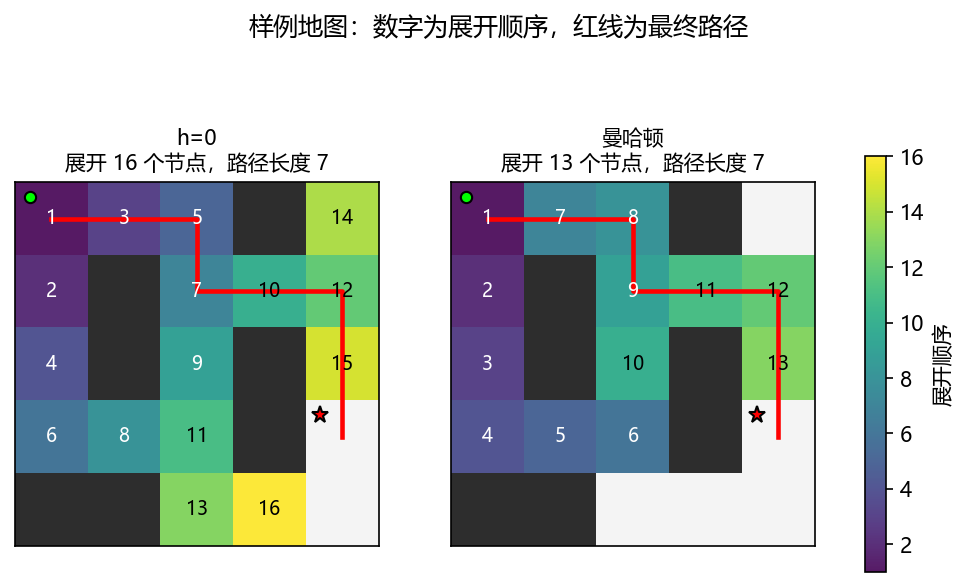
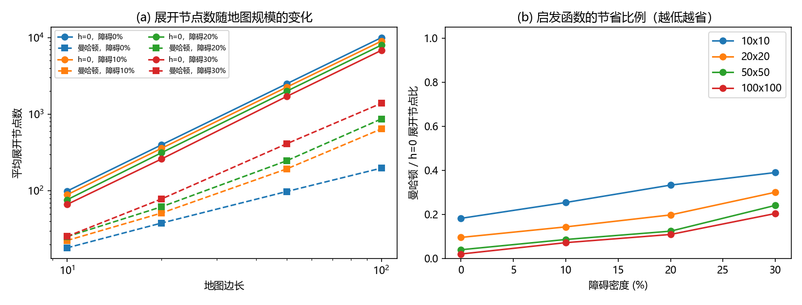
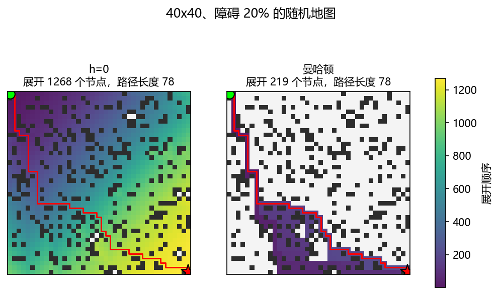
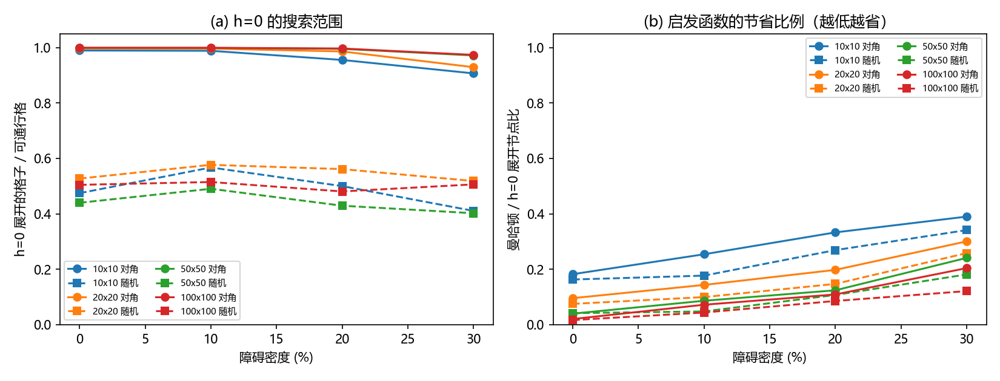
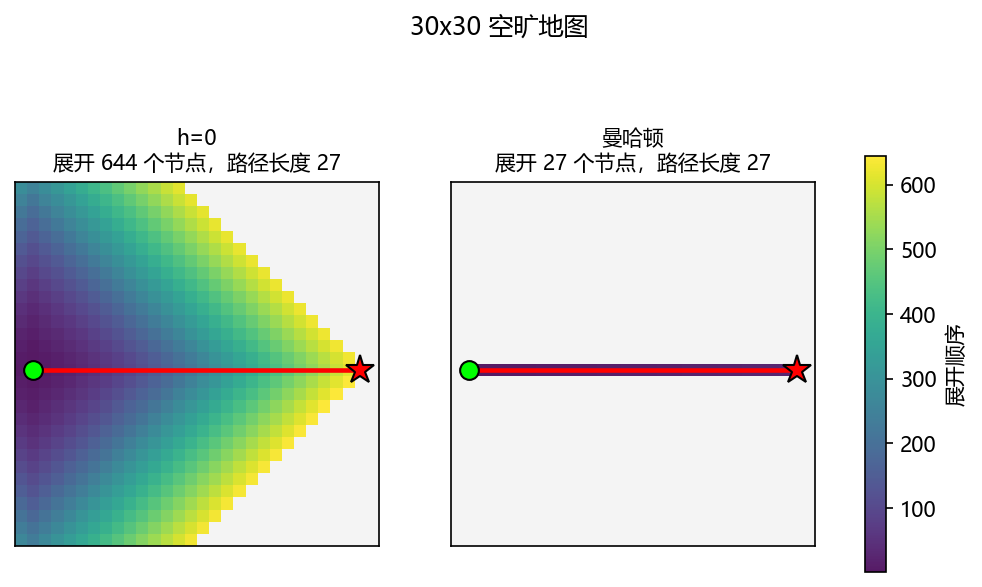
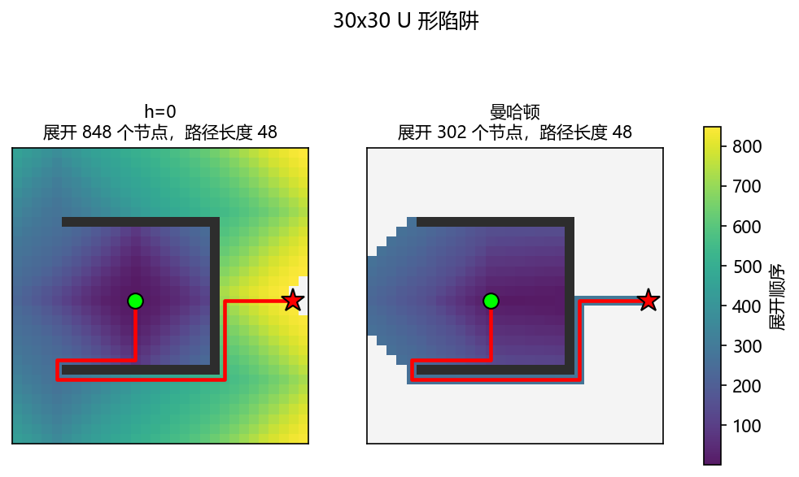
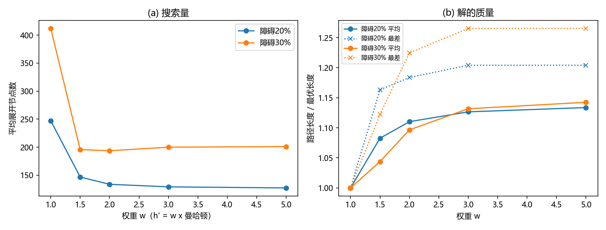
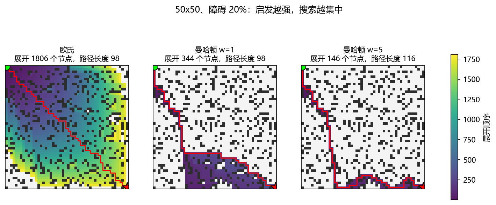

# 题目一 对照实验结果

由 `python -m experiments.exp_p1` 自动生成。

## E1 样例：h=0 与曼哈顿距离

| 启发函数 | 路径步数 | 展开节点 | 入队次数 | 开放表峰值 |
|---|---|---|---|---|
| h=0 | 7 | 16 | 18 | 3 |
| 曼哈顿 | 7 | 13 | 17 | 4 |

### 曼哈顿距离逐步过程

| 轮次 | 出队节点 | g | h | f | 父节点 | 新加入开放表 (节点:f) | 开放表大小 |
|---|---|---|---|---|---|---|---|
| 1 | (0, 0) | 0 | 7 | 7 | - | (1, 0):7, (0, 1):7 | 2 |
| 2 | (1, 0) | 1 | 6 | 7 | (0, 0) | (2, 0):7 | 2 |
| 3 | (2, 0) | 2 | 5 | 7 | (1, 0) | (3, 0):7 | 2 |
| 4 | (3, 0) | 3 | 4 | 7 | (2, 0) | (3, 1):7 | 2 |
| 5 | (3, 1) | 4 | 3 | 7 | (3, 0) | (3, 2):7 | 2 |
| 6 | (3, 2) | 5 | 2 | 7 | (3, 1) | (2, 2):9, (4, 2):9 | 3 |
| 7 | (0, 1) | 1 | 6 | 7 | (0, 0) | (0, 2):7 | 3 |
| 8 | (0, 2) | 2 | 5 | 7 | (0, 1) | (1, 2):7 | 3 |
| 9 | (1, 2) | 3 | 4 | 7 | (0, 2) | (2, 2):7, (1, 3):7 | 4 |
| 10 | (2, 2) | 4 | 3 | 7 | (1, 2) | （无） | 3 |
| 11 | (1, 3) | 4 | 3 | 7 | (1, 2) | (1, 4):7 | 3 |
| 12 | (1, 4) | 5 | 2 | 7 | (1, 3) | (0, 4):9, (2, 4):7 | 4 |
| 13 | (2, 4) | 6 | 1 | 7 | (1, 4) | (3, 4):7 | 4 |
| 终止 | (3, 4) | 7 | 0 | 7 | (2, 4) | 终点出队，搜索结束 | |

### h=0 逐步过程

| 轮次 | 出队节点 | g | h | f | 父节点 | 新加入开放表 (节点:f) | 开放表大小 |
|---|---|---|---|---|---|---|---|
| 1 | (0, 0) | 0 | 0 | 0 | - | (1, 0):1, (0, 1):1 | 2 |
| 2 | (1, 0) | 1 | 0 | 1 | (0, 0) | (2, 0):2 | 2 |
| 3 | (0, 1) | 1 | 0 | 1 | (0, 0) | (0, 2):2 | 2 |
| 4 | (2, 0) | 2 | 0 | 2 | (1, 0) | (3, 0):3 | 2 |
| 5 | (0, 2) | 2 | 0 | 2 | (0, 1) | (1, 2):3 | 2 |
| 6 | (3, 0) | 3 | 0 | 3 | (2, 0) | (3, 1):4 | 2 |
| 7 | (1, 2) | 3 | 0 | 3 | (0, 2) | (2, 2):4, (1, 3):4 | 3 |
| 8 | (3, 1) | 4 | 0 | 4 | (3, 0) | (3, 2):5 | 3 |
| 9 | (2, 2) | 4 | 0 | 4 | (1, 2) | （无） | 2 |
| 10 | (1, 3) | 4 | 0 | 4 | (1, 2) | (1, 4):5 | 2 |
| 11 | (3, 2) | 5 | 0 | 5 | (3, 1) | (4, 2):6 | 2 |
| 12 | (1, 4) | 5 | 0 | 5 | (1, 3) | (0, 4):6, (2, 4):6 | 3 |
| 13 | (4, 2) | 6 | 0 | 6 | (3, 2) | (4, 3):7 | 3 |
| 14 | (0, 4) | 6 | 0 | 6 | (1, 4) | （无） | 2 |
| 15 | (2, 4) | 6 | 0 | 6 | (1, 4) | (3, 4):7 | 2 |
| 16 | (4, 3) | 7 | 0 | 7 | (4, 2) | (4, 4):8 | 2 |
| 终止 | (3, 4) | 7 | 0 | 7 | (2, 4) | 终点出队，搜索结束 | |

## E2 地图规模 x 障碍密度（起点左上、终点右下；每格 20 张随机图取平均）

| 边长 | 障碍密度 | 可通行格 | 最短路步数 | 展开(h=0) | 展开(曼哈顿) | 曼哈顿/h=0 | h=0展开占可通行格比例 | 耗时ms(h=0) | 耗时ms(曼哈顿) | 起终点曼哈顿距离 |
|---|---|---|---|---|---|---|---|---|---|---|
| 10 | 0% | 100 | 18 | 99 | 18 | 0.182 | 0.99 | 0.254 | 0.06 | 18 |
| 10 | 10% | 89.6 | 18 | 88.6 | 22.45 | 0.254 | 0.989 | 0.237 | 0.077 | 18 |
| 10 | 20% | 79.7 | 18 | 76.25 | 25.2 | 0.333 | 0.956 | 0.2 | 0.091 | 18 |
| 10 | 30% | 72.9 | 18.4 | 66.3 | 25.35 | 0.39 | 0.907 | 0.17 | 0.082 | 18 |
| 20 | 0% | 400 | 38 | 399 | 38 | 0.095 | 0.998 | 1.508 | 0.202 | 38 |
| 20 | 10% | 360.5 | 38 | 359.3 | 51.35 | 0.143 | 0.997 | 1.049 | 0.204 | 38 |
| 20 | 20% | 319.1 | 38.3 | 314.85 | 61.95 | 0.197 | 0.986 | 1.018 | 0.246 | 38 |
| 20 | 30% | 280.3 | 40.2 | 260.85 | 78.4 | 0.3 | 0.93 | 1.058 | 0.402 | 38 |
| 50 | 0% | 2500 | 98 | 2499 | 98 | 0.039 | 1 | 8.915 | 0.455 | 98 |
| 50 | 10% | 2257.9 | 98 | 2256.3 | 193.4 | 0.086 | 0.999 | 7.904 | 0.924 | 98 |
| 50 | 20% | 2008.05 | 98 | 1999.65 | 247.05 | 0.124 | 0.996 | 8.113 | 1.252 | 98 |
| 50 | 30% | 1756.65 | 101 | 1707.6 | 411.85 | 0.241 | 0.972 | 8.665 | 2.774 | 98 |
| 100 | 0% | 10000 | 198 | 9999 | 198 | 0.02 | 1 | 61.371 | 1.534 | 198 |
| 100 | 10% | 9002.05 | 198 | 8999.65 | 642.95 | 0.071 | 1 | 50.601 | 5.317 | 198 |
| 100 | 20% | 8010.45 | 198 | 7987.9 | 868.35 | 0.109 | 0.997 | 45.774 | 6.624 | 198 |
| 100 | 30% | 7002.7 | 201.4 | 6821.6 | 1390.45 | 0.204 | 0.974 | 37.015 | 9.689 | 198 |

## E2b 对照：起点和终点随机选取（每格 20 张随机图取平均）

| 边长 | 障碍密度 | 可通行格 | 最短路步数 | 展开(h=0) | 展开(曼哈顿) | 曼哈顿/h=0 | h=0展开占可通行格比例 | 耗时ms(h=0) | 耗时ms(曼哈顿) | 起终点曼哈顿距离 |
|---|---|---|---|---|---|---|---|---|---|---|
| 10 | 0% | 100 | 6.65 | 47.45 | 6.65 | 0.163 | 0.475 | 0.243 | 0.055 | 6.65 |
| 10 | 10% | 89.6 | 7.7 | 51.1 | 9.3 | 0.177 | 0.567 | 0.232 | 0.066 | 7.4 |
| 10 | 20% | 80.4 | 7.25 | 40.4 | 9.45 | 0.269 | 0.5 | 0.198 | 0.066 | 6.55 |
| 10 | 30% | 69.8 | 7.65 | 28.55 | 10.3 | 0.341 | 0.41 | 0.155 | 0.072 | 5.75 |
| 20 | 0% | 400 | 13.8 | 210.9 | 13.8 | 0.074 | 0.527 | 1.071 | 0.115 | 13.8 |
| 20 | 10% | 359.3 | 15.5 | 206.6 | 18.5 | 0.099 | 0.577 | 1.062 | 0.136 | 15.2 |
| 20 | 20% | 321.2 | 15.35 | 179.6 | 23.55 | 0.147 | 0.561 | 0.856 | 0.152 | 13.45 |
| 20 | 30% | 280.7 | 18.35 | 144.35 | 37.55 | 0.258 | 0.518 | 0.778 | 0.241 | 14.05 |
| 50 | 0% | 2500 | 28.6 | 1099.55 | 28.6 | 0.041 | 0.44 | 6.225 | 0.284 | 28.6 |
| 50 | 10% | 2252.45 | 29.6 | 1102.85 | 48.4 | 0.047 | 0.49 | 5.812 | 0.35 | 29.2 |
| 50 | 20% | 2001.3 | 32.95 | 857.9 | 103.25 | 0.107 | 0.429 | 4.331 | 0.684 | 30.55 |
| 50 | 30% | 1755.3 | 34.25 | 706.15 | 152.2 | 0.181 | 0.402 | 3.863 | 1.203 | 26.25 |
| 100 | 0% | 10000 | 70.4 | 5045.7 | 70.4 | 0.016 | 0.505 | 19.184 | 0.418 | 70.4 |
| 100 | 10% | 9007.3 | 63.1 | 4637.25 | 193.4 | 0.043 | 0.515 | 25.731 | 1.518 | 62.6 |
| 100 | 20% | 8006.2 | 67.05 | 3848.65 | 385.95 | 0.085 | 0.481 | 14.966 | 1.954 | 64.15 |
| 100 | 30% | 7009.85 | 77.95 | 3548.45 | 441.9 | 0.121 | 0.506 | 19.17 | 2.586 | 68.55 |

### 与 E2（对角起终点）的对比

| 边长 | 障碍密度 | h=0展开比例(对角) | h=0展开比例(随机) | 曼哈顿/h=0(对角) | 曼哈顿/h=0(随机) |
|---|---|---|---|---|---|
| 10 | 0% | 0.99 | 0.475 | 0.182 | 0.163 |
| 10 | 10% | 0.989 | 0.567 | 0.254 | 0.177 |
| 10 | 20% | 0.956 | 0.5 | 0.333 | 0.269 |
| 10 | 30% | 0.907 | 0.41 | 0.39 | 0.341 |
| 20 | 0% | 0.998 | 0.527 | 0.095 | 0.074 |
| 20 | 10% | 0.997 | 0.577 | 0.143 | 0.099 |
| 20 | 20% | 0.986 | 0.561 | 0.197 | 0.147 |
| 20 | 30% | 0.93 | 0.518 | 0.3 | 0.258 |
| 50 | 0% | 1 | 0.44 | 0.039 | 0.041 |
| 50 | 10% | 0.999 | 0.49 | 0.086 | 0.047 |
| 50 | 20% | 0.996 | 0.429 | 0.124 | 0.107 |
| 50 | 30% | 0.972 | 0.402 | 0.241 | 0.181 |
| 100 | 0% | 1 | 0.505 | 0.02 | 0.016 |
| 100 | 10% | 1 | 0.515 | 0.071 | 0.043 |
| 100 | 20% | 0.997 | 0.481 | 0.109 | 0.085 |
| 100 | 30% | 0.974 | 0.506 | 0.204 | 0.121 |

## E3 平局规则（f 相同时先展开谁）

| 地图 | 启发函数 | low_h（h小优先） | fifo（先入先出） | lifo（后入先出） |
|---|---|---|---|---|
| 样例 5x5 | h=0 | 16 | 16 | 15 |
| 样例 5x5 | 曼哈顿 | 13 | 13 | 7 |
| 50x50 无障碍 | h=0 | 2499 | 2499 | 2499 |
| 50x50 无障碍 | 曼哈顿 | 98 | 2499 | 98 |
| 50x50 障碍20% | h=0 | 1999.65 | 1999.65 | 1999.55 |
| 50x50 障碍20% | 曼哈顿 | 247.05 | 1292.35 | 245.4 |

## E4 特殊地图

| 地图 | 最短路步数 | 可通行格 | 展开(h=0) | 展开(曼哈顿) | 曼哈顿/h=0 |
|---|---|---|---|---|---|
| 30x30 空旷地图 | 27 | 900 | 644 | 27 | 0.042 |
| 30x30 U 形陷阱 | 48 | 854 | 848 | 302 | 0.356 |

## E5 加权 A* 与欧氏距离（50x50，每种密度 20 张图）

| 障碍密度 | 配置 | 平均展开 | 平均路径/最优 | 最差路径/最优 | 得到最优解的比例 |
|---|---|---|---|---|---|
| 20% | h=0 | 1999.65 | 1 | 1 | 1 |
| 20% | 欧氏 | 1769.6 | 1 | 1 | 1 |
| 20% | 曼哈顿 w=1 | 247.05 | 1 | 1 | 1 |
| 20% | 曼哈顿 w=1.5 | 146.7 | 1.083 | 1.163 | 0 |
| 20% | 曼哈顿 w=2 | 133.7 | 1.11 | 1.184 | 0 |
| 20% | 曼哈顿 w=3 | 129.15 | 1.127 | 1.204 | 0 |
| 20% | 曼哈顿 w=5 | 127.25 | 1.134 | 1.204 | 0 |
| 30% | h=0 | 1707.6 | 1 | 1 | 1 |
| 30% | 欧氏 | 1289.5 | 1 | 1 | 1 |
| 30% | 曼哈顿 w=1 | 411.85 | 1 | 1 | 1 |
| 30% | 曼哈顿 w=1.5 | 195.65 | 1.044 | 1.122 | 0.2 |
| 30% | 曼哈顿 w=2 | 193.6 | 1.097 | 1.224 | 0 |
| 30% | 曼哈顿 w=3 | 199.95 | 1.132 | 1.265 | 0 |
| 30% | 曼哈顿 w=5 | 200.95 | 1.142 | 1.265 | 0 |

### 相邻权重的配对检验（同一批地图；差值 = 后者 − 前者，± 为标准误，|t| ≥ 2 视为显著）

| 障碍密度 | 比较 | 展开数差值 | t | 判断 | 路径/最优 差值 | t | 判断 |
|---|---|---|---|---|---|---|---|
| 20% | w=1 → 1.5 | -100.3 ± 11.5 | -8.69 | 显著 | +0.083 ± 0.008 | 10.28 | 显著 |
| 20% | w=1.5 → 2 | -13.0 ± 4.1 | -3.20 | 显著 | +0.028 ± 0.006 | 4.93 | 显著 |
| 20% | w=2 → 3 | -4.5 ± 2.1 | -2.22 | 显著 | +0.016 ± 0.004 | 3.76 | 显著 |
| 20% | w=3 → 5 | -1.9 ± 1.0 | -1.82 | 不显著 | +0.007 ± 0.003 | 2.33 | 显著 |
| 30% | w=1 → 1.5 | -216.2 ± 65.7 | -3.29 | 显著 | +0.044 ± 0.009 | 4.70 | 显著 |
| 30% | w=1.5 → 2 | -2.0 ± 9.4 | -0.22 | 不显著 | +0.053 ± 0.010 | 5.26 | 显著 |
| 30% | w=2 → 3 | +6.3 ± 10.2 | 0.62 | 不显著 | +0.035 ± 0.009 | 3.89 | 显著 |
| 30% | w=3 → 5 | +1.0 ± 3.5 | 0.29 | 不显著 | +0.011 ± 0.005 | 2.03 | 显著 |

## E6 展开节点分解（50x50，起点左上、终点右下，每档 20 张；已校验实际展开与理论一致）

| 障碍 | 绕路量 C*-d | f<C* 节点（必须展开） | f=C* 节点（看平局） | 展开(h小优先) | 展开(先进先出) | 展开(h=0) | h小优先中必须展开的占比 |
|---|---|---|---|---|---|---|---|
| 0% | 0 | 0 | 2500 | 98 | 2499 | 2499 | 0 |
| 10% | 0 | 0 | 1994.55 | 193.4 | 1993.55 | 2256.3 | 0 |
| 20% | 0 | 0 | 1293.35 | 247.05 | 1292.35 | 1999.65 | 0 |
| 30% | 3 | 247.95 | 420.9 | 411.85 | 660.4 | 1707.6 | 0.381 |
