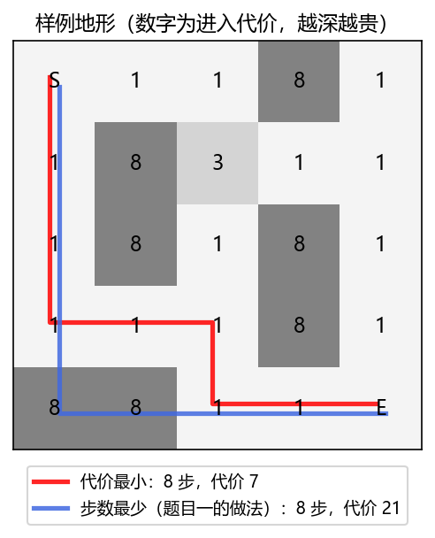
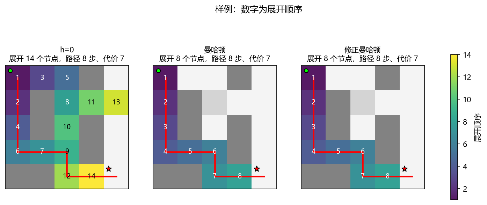
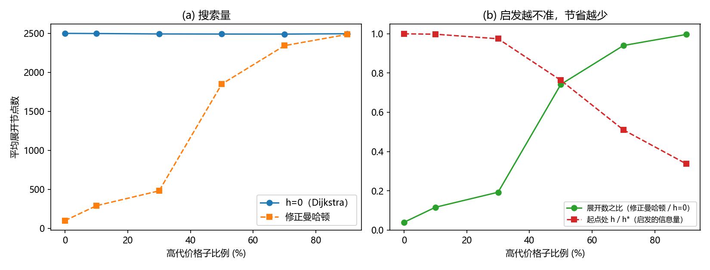
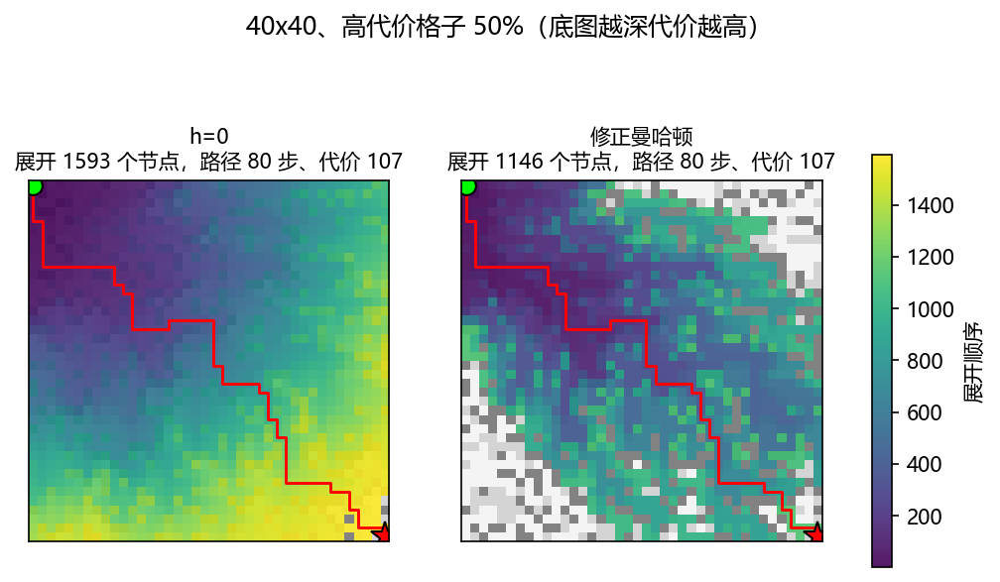
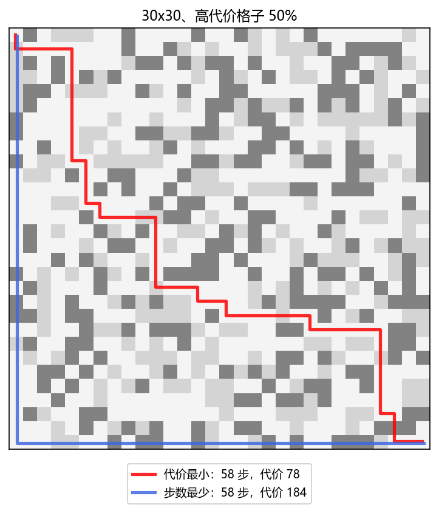
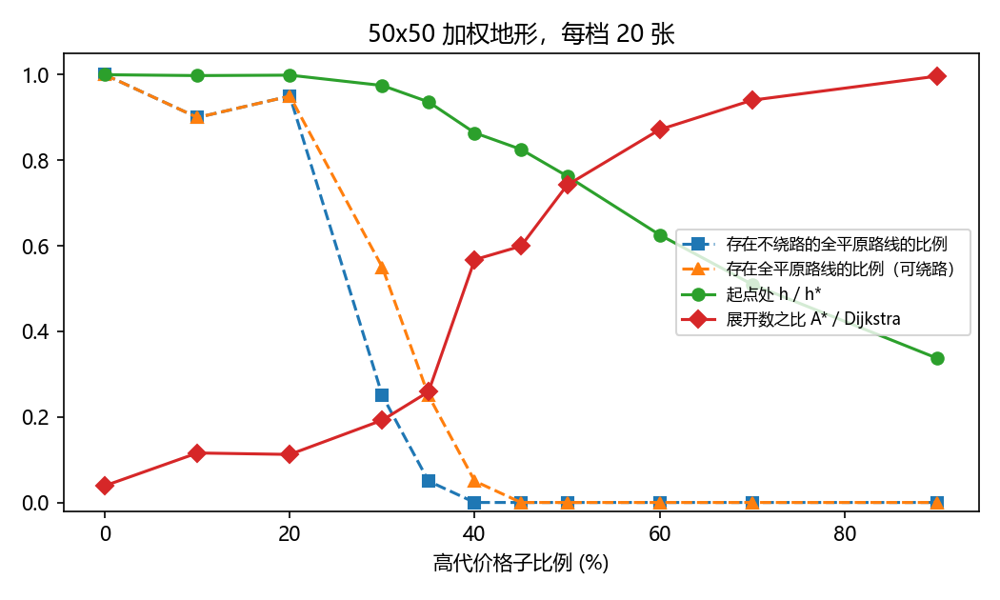

# 题目二 对照实验结果

由 `python -m experiments.exp_p2` 自动生成。

## E1 样例

### 路径代价的累计过程

| 步 | 坐标 | 地形 | 本步代价 | 累计代价 |
|---|---|---|---|---|
| 0 | (0, 0) | S | 0 | 0 |
| 1 | (1, 0) | 1 | 1 | 1 |
| 2 | (2, 0) | 1 | 1 | 2 |
| 3 | (3, 0) | 1 | 1 | 3 |
| 4 | (3, 1) | 1 | 1 | 4 |
| 5 | (3, 2) | 1 | 1 | 5 |
| 6 | (4, 2) | 1 | 1 | 6 |
| 7 | (4, 3) | 1 | 1 | 7 |
| 8 | (4, 4) | E | 0 | 7 |

### 每个格子的真实剩余代价 h*（反向 Dijkstra 求得）

| 行\列 | 0 | 1 | 2 | 3 | 4 |
|---|---|---|---|---|---|
| 0 | 7 | 8 | 7 | 4 | 3 |
| 1 | 6 | 7 | 4 | 3 | 2 |
| 2 | 5 | 4 | 3 | 2 | 1 |
| 3 | 4 | 3 | 2 | 1 | 0 |
| 4 | 5 | 2 | 1 | 0 | 0 |

### 曼哈顿距离 h（加粗 = 高估，即 h > h*）

| 行\列 | 0 | 1 | 2 | 3 | 4 |
|---|---|---|---|---|---|
| 0 | **8** | 7 | 6 | **5** | **4** |
| 1 | **7** | 6 | **5** | **4** | **3** |
| 2 | **6** | **5** | **4** | **3** | **2** |
| 3 | **5** | **4** | **3** | **2** | **1** |
| 4 | 4 | **3** | **2** | **1** | 0 |

### 修正曼哈顿 h = (d-1) x 最小代价 + 终点代价（加粗 = 高估）

| 行\列 | 0 | 1 | 2 | 3 | 4 |
|---|---|---|---|---|---|
| 0 | 7 | 6 | 5 | 4 | 3 |
| 1 | 6 | 5 | 4 | 3 | 2 |
| 2 | 5 | 4 | 3 | 2 | 1 |
| 3 | 4 | 3 | 2 | 1 | 0 |
| 4 | 3 | 2 | 1 | 0 | 0 |

### 各启发函数的性质与结果

| 启发函数 | 高估格子 | 最大高估量 | 不一致的边 | 求得代价 | 展开节点 |
|---|---|---|---|---|---|
| h=0 | 0/25 | 0 | 0/80 | 7 | 14 |
| 曼哈顿 | 20/25 | 1 | 2/80 | 7 | 8 |
| 修正曼哈顿 | 0/25 | 0 | 0/80 | 7 | 8 |
| 平均代价x曼哈顿 | 24/25 | 18 | 28/80 | 7 | 8 |

### 修正曼哈顿的逐步过程

| 轮次 | 出队节点 | g | h | f | 父节点 | 新加入开放表 (节点:f) | 开放表大小 |
|---|---|---|---|---|---|---|---|
| 1 | (0, 0) | 0 | 7 | 7 | - | (1, 0):7, (0, 1):7 | 2 |
| 2 | (1, 0) | 1 | 6 | 7 | (0, 0) | (2, 0):7, (1, 1):14 | 3 |
| 3 | (2, 0) | 2 | 5 | 7 | (1, 0) | (3, 0):7, (2, 1):14 | 4 |
| 4 | (3, 0) | 3 | 4 | 7 | (2, 0) | (4, 0):14, (3, 1):7 | 5 |
| 5 | (3, 1) | 4 | 3 | 7 | (3, 0) | (4, 1):14, (3, 2):7 | 6 |
| 6 | (3, 2) | 5 | 2 | 7 | (3, 1) | (2, 2):9, (4, 2):7, (3, 3):14 | 8 |
| 7 | (4, 2) | 6 | 1 | 7 | (3, 2) | (4, 3):7 | 8 |
| 8 | (4, 3) | 7 | 0 | 7 | (4, 2) | (4, 4):7 | 8 |
| 终止 | (4, 4) | 7 | 0 | 7 | (4, 3) | 终点出队，搜索结束 | |

## E2 可采纳性与最优性（50x50，每种地形 20 张图）

| 地形 | 启发函数 | 高估格子比例 | 最大高估量 | 不一致边比例 | 平均展开 | 平均重新打开 | 次优解比例 | 最大超出最优 |
|---|---|---|---|---|---|---|---|---|
| 平原为主 | h=0 | 0.0% | 0 | 0.00% | 2494.7 | 0 | 0% | 0.0% |
| 平原为主 | 曼哈顿 | 62.0% | 1 | 0.02% | 280.1 | 0 | 0% | 0.0% |
| 平原为主 | 修正曼哈顿 | 0.0% | 0 | 0.00% | 280.25 | 0 | 0% | 0.0% |
| 平原为主 | 平均代价x曼哈顿 | 99.9% | 93.745 | 40.06% | 119.9 | 2.85 | 100% | 23.7% |
| 混合 | h=0 | 0.0% | 0 | 0.00% | 2490.25 | 0 | 0% | 0.0% |
| 混合 | 曼哈顿 | 0.6% | 1 | 0.02% | 1848.85 | 0 | 0% | 0.0% |
| 混合 | 修正曼哈顿 | 0.0% | 0 | 0.00% | 1849 | 0 | 0% | 0.0% |
| 混合 | 平均代价x曼哈顿 | 99.8% | 204.176 | 37.51% | 117.65 | 2.15 | 100% | 47.3% |
| 沼泽为主 | h=0 | 0.0% | 0 | 0.00% | 2494.25 | 0 | 0% | 0.0% |
| 沼泽为主 | 曼哈顿 | 0.1% | 1 | 0.02% | 2478.55 | 0 | 0% | 0.0% |
| 沼泽为主 | 修正曼哈顿 | 0.0% | 0 | 0.00% | 2478.6 | 0 | 0% | 0.0% |
| 沼泽为主 | 平均代价x曼哈顿 | 99.8% | 242.039 | 29.89% | 116.45 | 2.15 | 100% | 38.7% |

## E2b 大批量最优性校验（2000 张 4~15 边长的随机地图，含障碍）

| 启发函数 | 平局规则 | 求解次数 | 次优次数 | 次优比例 | 最大超出最优 |
|---|---|---|---|---|---|
| 曼哈顿 | low_h | 2000 | 0 | 0.0% | 0.0% |
| 修正曼哈顿 | low_h | 2000 | 0 | 0.0% | 0.0% |
| 平均代价x曼哈顿 | low_h | 2000 | 824 | 41.2% | 84.6% |
| 曼哈顿 | fifo | 2000 | 0 | 0.0% | 0.0% |
| 修正曼哈顿 | fifo | 2000 | 0 | 0.0% | 0.0% |
| 平均代价x曼哈顿 | fifo | 2000 | 820 | 41.0% | 84.6% |
| 曼哈顿 | lifo | 2000 | 0 | 0.0% | 0.0% |
| 修正曼哈顿 | lifo | 2000 | 0 | 0.0% | 0.0% |
| 平均代价x曼哈顿 | lifo | 2000 | 811 | 40.6% | 81.5% |

曼哈顿的展开数不多于修正曼哈顿的情况：6000/6000。

## E3 地形差异（50x50，每档 20 张图）

| 高代价比例 | 平均最优代价 | 展开(h=0) | 展开(修正曼哈顿) | 比值 | 起点 h/h* |
|---|---|---|---|---|---|
| 0% | 97 | 2499 | 98 | 0.039 | 1 |
| 10% | 97.2 | 2496.9 | 288.9 | 0.116 | 0.998 |
| 30% | 99.55 | 2491.55 | 479.6 | 0.192 | 0.975 |
| 50% | 127.55 | 2490.25 | 1849 | 0.742 | 0.763 |
| 70% | 191.15 | 2489.75 | 2341.75 | 0.94 | 0.51 |
| 90% | 288 | 2494.15 | 2485.7 | 0.997 | 0.337 |

## E4 步数最少 vs 代价最小（30x30，每档 20 张图）

| 高代价比例 | 最优代价 | 步数最少路径的代价 | 代价之比 | 最优路径步数 | 最少步数 |
|---|---|---|---|---|---|
| 30% | 59.55 | 134.5 | 2.261 | 58.2 | 58 |
| 60% | 94.55 | 214.15 | 2.277 | 58.8 | 58 |

## E5 启发函数改进：统计最小代价时排除起点（50x50，高代价格子 50%，每档 20 张图）

高估格子按"不经过起点的路径"计算真实剩余代价：从起点出发的搜索，剩余路径不会再经过起点。

| 最便宜的地形代价 | 启发函数 | 平均展开 | 高估格子（最大） | 起点处 h/h* |
|---|---|---|---|---|
| 1（高代价取 (3, 8)） | h=0（Dijkstra） | 2490.25 | 0 | 0 |
| 1（高代价取 (3, 8)） | 改进前：w_min 含起点 | 1849 | 0 | 0.763 |
| 1（高代价取 (3, 8)） | 改进后：w_min 排除起点 | 1849 | 0 | 0.763 |
| 2（高代价取 (5, 9)） | h=0（Dijkstra） | 2494.15 | 0 | 0 |
| 2（高代价取 (5, 9)） | 改进前：w_min 含起点 | 2484.35 | 0 | 0.408 |
| 2（高代价取 (5, 9)） | 改进后：w_min 排除起点 | 1864 | 0 | 0.817 |
| 3（高代价取 (5, 9)） | h=0（Dijkstra） | 2496.75 | 0 | 0 |
| 3（高代价取 (5, 9)） | 改进前：w_min 含起点 | 2493.6 | 0 | 0.302 |
| 3（高代价取 (5, 9)） | 改进后：w_min 排除起点 | 1601.15 | 0 | 0.906 |

## E6 渗流分析（50x50，每档 20 张）

| 高代价比例 | 平原比例 | 存在不绕路全平原路线 | 存在全平原路线 | 起点 h/h* | A*/Dijkstra 展开比 |
|---|---|---|---|---|---|
| 0% | 100% | 1 | 1 | 1 | 0.039 |
| 10% | 90% | 0.9 | 0.9 | 0.998 | 0.116 |
| 20% | 80% | 0.95 | 0.95 | 0.999 | 0.112 |
| 30% | 70% | 0.25 | 0.55 | 0.975 | 0.192 |
| 35% | 65% | 0.05 | 0.25 | 0.936 | 0.259 |
| 40% | 60% | 0 | 0.05 | 0.864 | 0.568 |
| 45% | 55% | 0 | 0 | 0.826 | 0.599 |
| 50% | 50% | 0 | 0 | 0.763 | 0.742 |
| 60% | 40% | 0 | 0 | 0.626 | 0.872 |
| 70% | 30% | 0 | 0 | 0.51 | 0.94 |
| 90% | 10% | 0 | 0 | 0.337 | 0.997 |
