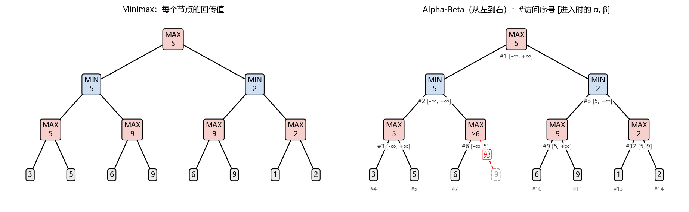
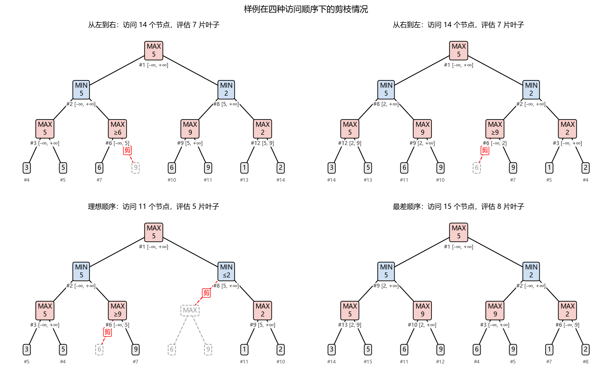
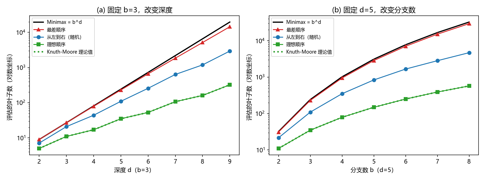
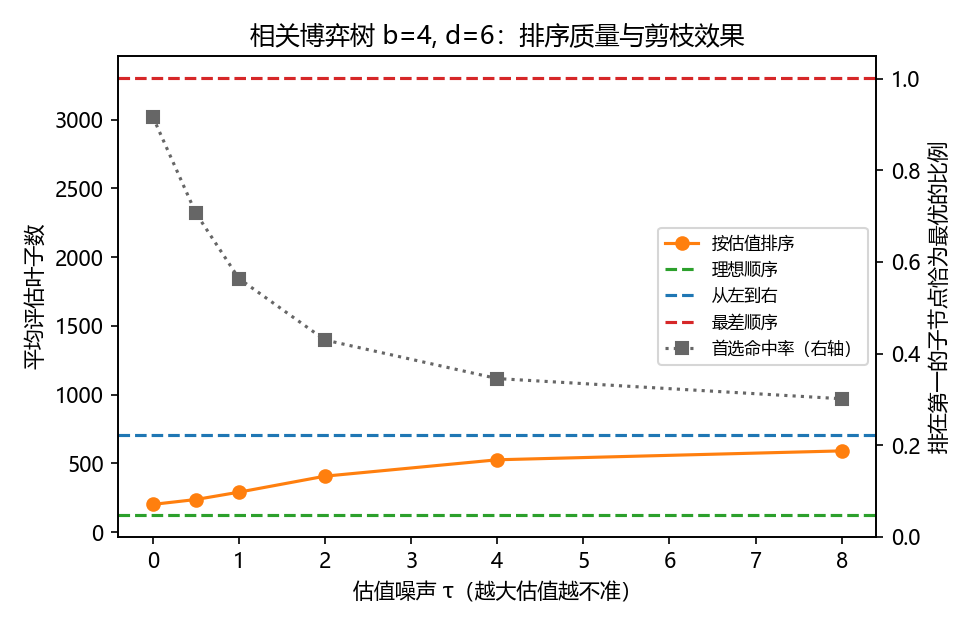
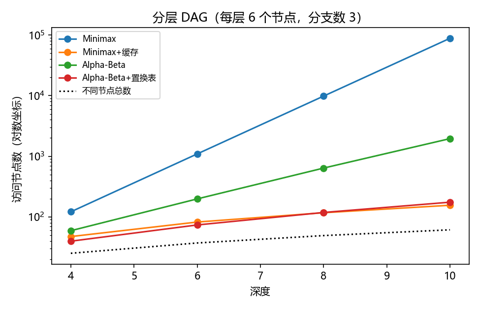

# 题目三 对照实验结果

由 `python -m experiments.exp_p3` 自动生成。

## E1 样例

### Alpha-Beta 逐节点过程（从左到右，先序）

| 序号 | 节点 | 类型 | 进入时 α | 进入时 β | 返回值 | 说明 |
|---|---|---|---|---|---|---|
| 1 | root | MAX | -∞ | +∞ | 5 | 子节点全部访问 |
| 2 | root-0 | MIN | -∞ | +∞ | 5 | 子节点全部访问 |
| 3 | root-0-0 | MAX | -∞ | +∞ | 5 | 子节点全部访问 |
| 4 | root-0-0-0 | 叶子 | -∞ | +∞ | 3 |  |
| 5 | root-0-0-1 | 叶子 | 3 | +∞ | 5 |  |
| 6 | root-0-1 | MAX | -∞ | 5 | ≥6 | α=6 ≥ β=5，剪掉子节点 [1]；返回值只是下界 |
| 7 | root-0-1-0 | 叶子 | -∞ | 5 | 6 |  |
| 8 | root-1 | MIN | 5 | +∞ | 2 | 子节点全部访问 |
| 9 | root-1-0 | MAX | 5 | +∞ | 9 | 子节点全部访问 |
| 10 | root-1-0-0 | 叶子 | 5 | +∞ | 6 |  |
| 11 | root-1-0-1 | 叶子 | 6 | +∞ | 9 |  |
| 12 | root-1-1 | MAX | 5 | 9 | 2 | 子节点全部访问 |
| 13 | root-1-1-0 | 叶子 | 5 | 9 | 1 |  |
| 14 | root-1-1-1 | 叶子 | 5 | 9 | 2 |  |

### 四种访问顺序

| 方法 / 访问顺序 | 根节点值 | 访问节点 | 评估叶子 | 剪枝次数 |
|---|---|---|---|---|
| Minimax（不剪枝） | 5 | 15 | 8 | 0 |
| 从左到右 | 5 | 14 | 7 | 1 |
| 从右到左 | 5 | 14 | 7 | 1 |
| 理想顺序 | 5 | 11 | 5 | 2 |
| 最差顺序 | 5 | 15 | 8 | 0 |

## E2 随机博弈树（叶子为 [0,1) 随机实数，每组 10 棵树取平均）

| 扫描 | b | d | Minimax 叶子 b^d | Knuth-Moore 理论 | 理想顺序 | 从左到右 | 最差顺序 | 从左到右的有效分支数 | Minimax 耗时ms | Alpha-Beta 耗时ms |
|---|---|---|---|---|---|---|---|---|---|---|
| 深度 | 3 | 2 | 9 | 5 | 5 | 7.1 | 9 | 2.665 | 0.012 | 0.013 |
| 深度 | 3 | 3 | 27 | 11 | 11 | 20.9 | 27 | 2.755 | 0.036 | 0.039 |
| 深度 | 3 | 4 | 81 | 17 | 17 | 44 | 78.9 | 2.576 | 0.175 | 0.116 |
| 深度 | 3 | 5 | 243 | 35 | 35 | 109.6 | 230.2 | 2.558 | 0.288 | 0.215 |
| 深度 | 3 | 6 | 729 | 53 | 53 | 257.2 | 663.1 | 2.522 | 0.844 | 0.485 |
| 深度 | 3 | 7 | 2187 | 107 | 107 | 635.9 | 1851 | 2.515 | 2.513 | 1.146 |
| 深度 | 3 | 8 | 6561 | 161 | 161 | 1190 | 5153.6 | 2.424 | 8.404 | 6.125 |
| 深度 | 3 | 9 | 19683 | 323 | 323 | 2940.7 | 14454.4 | 2.429 | 23.165 | 6.451 |
| 分支数 | 2 | 5 | 32 | 11 | 11 | 21.6 | 31 | 1.849 | 0.071 | 0.062 |
| 分支数 | 3 | 5 | 243 | 35 | 35 | 109.6 | 230.2 | 2.558 | 0.258 | 0.178 |
| 分支数 | 4 | 5 | 1024 | 79 | 79 | 351.6 | 950.4 | 3.23 | 1.02 | 0.517 |
| 分支数 | 5 | 5 | 3125 | 149 | 149 | 839.5 | 2868.6 | 3.844 | 3.617 | 1.414 |
| 分支数 | 6 | 5 | 7776 | 251 | 251 | 1671.7 | 7082.2 | 4.412 | 8.103 | 2.578 |
| 分支数 | 7 | 5 | 16807 | 391 | 391 | 2837.9 | 15209.2 | 4.905 | 15.054 | 4.017 |
| 分支数 | 8 | 5 | 32768 | 575 | 575 | 4718.7 | 29623.6 | 5.43 | 27.842 | 6.615 |

## E3 启发式排序（相关博弈树 b=4, d=6，20 棵树取平均；Minimax 需评估 4096 片叶子）

| 访问顺序 | 平均评估叶子 | 首选命中率 |
|---|---|---|
| 理想顺序 | 127 | 100% |
| 估值排序 τ=0 | 202.1 | 92% |
| 估值排序 τ=0.5 | 237.65 | 71% |
| 估值排序 τ=1 | 291.1 | 56% |
| 估值排序 τ=2 | 407.45 | 43% |
| 估值排序 τ=4 | 526.5 | 35% |
| 估值排序 τ=8 | 591.15 | 30% |
| 从左到右（不排序） | 705.6 | - |
| 最差顺序 | 3303.05 | - |

## E4 剪枝条件（b=3, d=6，从左到右，20 棵树）

| 叶子取值 | α≥β 时剪（叶子数） | α>β 时剪（叶子数） | 比值 |
|---|---|---|---|
| 实数（几乎无相等） | 247.95 | 247.95 | 1 |
| 整数 0~9 | 204.05 | 340.8 | 0.6 |
| 整数 0~2（大量相等） | 127.1 | 395.4 | 0.334 |

## E5 置换表 / 缓存

### 样例

| 输入 | 方法 | 根节点值 | 访问节点 | 评估叶子 | 缓存命中 |
|---|---|---|---|---|---|
| TreeNode 版（max2 共享） | Minimax | 5 | 15 | 8 | 0 |
| TreeNode 版（max2 共享） | Minimax+缓存 | 5 | 13 | 6 | 1 |
| TreeNode 版（max2 共享） | Alpha-Beta | 5 | 14 | 7 | 0 |
| TreeNode 版（max2 共享） | Alpha-Beta+置换表 | 5 | 14 | 6 | 1 |
| JSON 版（max2 复制两份） | Minimax | 5 | 15 | 8 | 0 |
| JSON 版（max2 复制两份） | Minimax+缓存 | 5 | 15 | 8 | 0 |
| JSON 版（max2 复制两份） | Alpha-Beta | 5 | 14 | 7 | 0 |
| JSON 版（max2 复制两份） | Alpha-Beta+置换表 | 5 | 14 | 7 | 0 |

### 分层 DAG（大量共享节点，每个深度 5 个随机图）

| 深度 | 不同节点数 | Minimax | Minimax+缓存 | Alpha-Beta | Alpha-Beta+置换表 |
|---|---|---|---|---|---|
| 4 | 25 | 121 | 47.2 | 59 | 39.6 |
| 6 | 37 | 1093 | 82 | 197.6 | 73.4 |
| 8 | 49 | 9841 | 116.8 | 637.8 | 118 |
| 10 | 61 | 88573 | 155.2 | 1953.6 | 174.4 |

## E6 剪枝发生的位置（相关博弈树 b=4, d=6，20 棵）

| 访问顺序 | 评估叶子 | 剪枝次数 | 看完第一个子节点就剪枝的比例 |
|---|---|---|---|
| 理想顺序 | 127 | 99 | 100% |
| 估值排序 τ=0 | 202.1 | 124.95 | 99% |
| 估值排序 τ=1 | 291.1 | 152.6 | 93% |
| 估值排序 τ=4 | 526.5 | 201.85 | 81% |
| 从左到右 | 705.6 | 231.05 | 71% |
| 最差顺序 | 3303.05 | 250.8 | 27% |
