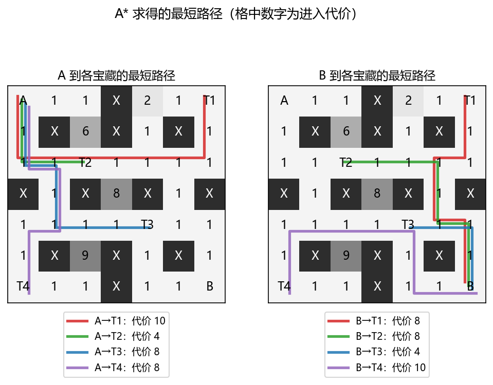
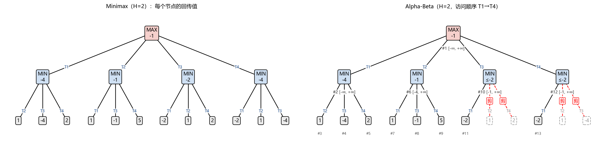
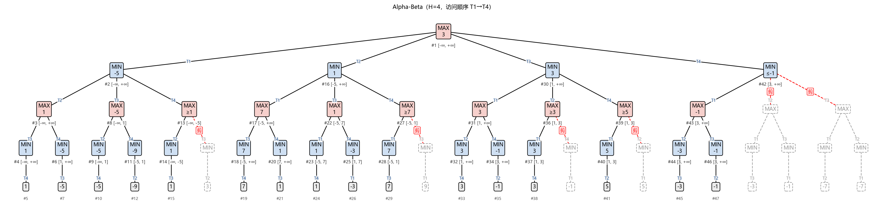
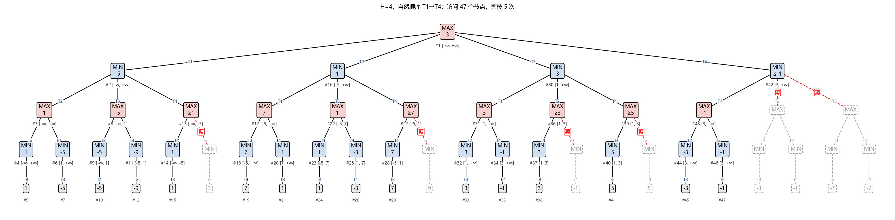
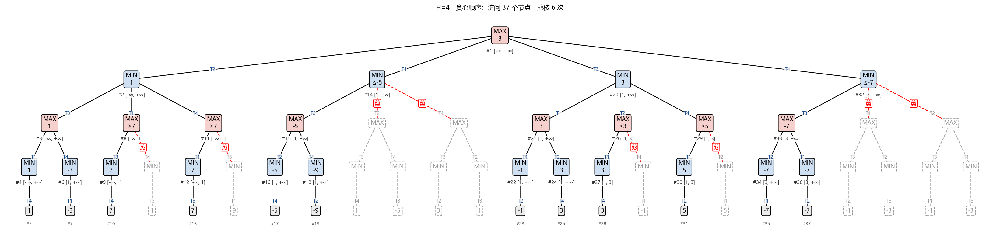
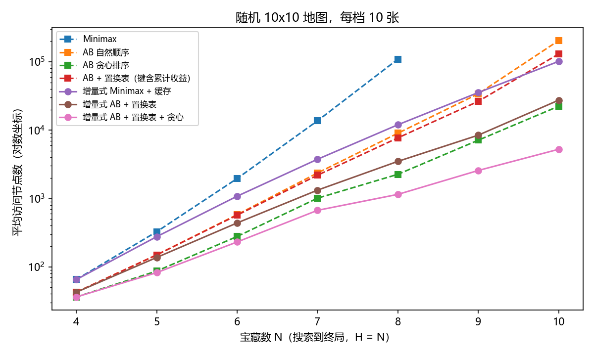
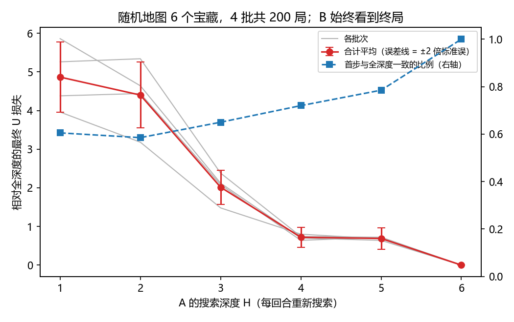

# 题目四 对照实验结果

由 `python -m experiments.exp_p4` 自动生成。

## E1 样例

### 距离矩阵（A* 计算，行 = 出发点，列 = 目标点）

|  | A | B | T1 | T2 | T3 | T4 |
|---|---|---|---|---|---|---|
| A | 0 | 12 | 10 | 4 | 8 | 8 |
| B | 12 | 0 | 8 | 8 | 4 | 10 |
| T1 | 10 | 8 | 0 | 6 | 6 | 12 |
| T2 | 4 | 8 | 6 | 0 | 6 | 6 |
| T3 | 8 | 4 | 6 | 6 | 0 | 6 |
| T4 | 8 | 10 | 12 | 6 | 6 | 0 |

矩阵对称：A、B、T 所在格进入代价都是 1，所以 d(p,q) = d(q,p)。

| 启发函数 | A* 调用次数 | 总展开节点 |
|---|---|---|
| 曼哈顿 x 最小代价 | 30 | 245 |
| h=0（Dijkstra） | 30 | 650 |

### 状态表示

|  | pos_a | pos_b | remaining | score_a | score_b | turn | U |
|---|---|---|---|---|---|---|---|
| 初始状态 | A | B | {T1,T2,T3,T4} | 0 | 0 | A | 0 |
| A 选 T2 之后 | T2 | B | {T1,T3,T4} | 2 | 0 | B | 2 |

### 各深度下每个首步的价值（加粗为最优）

| 深度 | T1 | T2 | T3 | T4 |
|---|---|---|---|---|
| H=1 | -1 | **2** | -1 | -1 |
| H=2 | -4 | **-1** | -2 | -4 |
| H=3 | -4 | **2** | -1 | -4 |
| H=4 | -5 | 1 | **3** | -7 |

| 深度 | 最优首步 | 最优收益差 | 主变例 |
|---|---|---|---|
| H=1 | T2 | 2 | A:A->T2(6-4=+2)  => U=2 |
| H=2 | T2 | -1 | A:A->T2(6-4=+2)  B:B->T3(7-4=+3)  => U=-1 |
| H=3 | T2 | 2 | A:A->T2(6-4=+2)  B:B->T1(9-8=+1)  A:T2->T3(7-6=+1)  => U=2 |
| H=4 | T3 | 3 | A:A->T3(7-8=-1)  B:B->T1(9-8=+1)  A:T3->T2(6-6=+0)  B:T1->T4(7-12=-5)  => U=3 |

### Minimax 与 Alpha-Beta（访问顺序 T1→T4）

| 深度 | 方法 | 最优首步 | 最优收益差 | 访问节点 | 评估叶子 | 剪枝次数 |
|---|---|---|---|---|---|---|
| H=2 | minimax | T2 | -1 | 17 | 12 | 0 |
| H=2 | alphabeta | T2 | -1 | 13 | 8 | 2 |
| H=4 | minimax | T3 | 3 | 65 | 24 | 0 |
| H=4 | alphabeta | T3 | 3 | 47 | 16 | 5 |

## E2 访问顺序与剪枝

| 深度 | 访问顺序 | 最优首步 | 最优收益差 | 访问节点 | 评估叶子 | 剪枝次数 |
|---|---|---|---|---|---|---|
| H=2 | Minimax（不剪枝） | T2 | -1 | 17 | 12 | 0 |
| H=2 | 自然（T1→T4） | T2 | -1 | 13 | 8 | 2 |
| H=2 | 反序（T4→T1） | T2 | -1 | 16 | 11 | 1 |
| H=2 | 贪心（即时收益高者先） | T2 | -1 | 11 | 6 | 3 |
| H=2 | 理想 | T2 | -1 | 11 | 6 | 3 |
| H=2 | 最差 | T2 | -1 | 17 | 12 | 0 |
| H=4 | Minimax（不剪枝） | T3 | 3 | 65 | 24 | 0 |
| H=4 | 自然（T1→T4） | T3 | 3 | 47 | 16 | 5 |
| H=4 | 反序（T4→T1） | T3 | 3 | 46 | 16 | 4 |
| H=4 | 贪心（即时收益高者先） | T3 | 3 | 37 | 12 | 6 |
| H=4 | 理想 | T3 | 3 | 31 | 10 | 5 |
| H=4 | 最差 | T3 | 3 | 65 | 24 | 0 |

## E3 状态设计、缓存与规模（随机 10x10 地图，每档 10 张，搜索到终局）

每个宝藏数对应三行：平均访问节点数、平均置换表命中次数、平均耗时。

| 宝藏数 | Minimax | AB 自然顺序 | AB 贪心排序 | AB + 置换表（键含累计收益） | 增量式 Minimax + 缓存 | 增量式 AB + 置换表 | 增量式 AB + 置换表 + 贪心 |
|---|---|---|---|---|---|---|---|
| 4 | 65 | 42 | 36 | 42 | 65 | 42 | 36 |
|  | 命中 0 | 命中 0 | 命中 0 | 命中 0 | 命中 0 | 命中 0 | 命中 0 |
|  | 0.3 ms | 0.2 ms | 0.2 ms | 0.3 ms | 0.4 ms | 0.3 ms | 0.2 ms |
| 5 | 326 | 149 | 86 | 149 | 276 | 137 | 82 |
|  | 命中 0 | 命中 0 | 命中 0 | 命中 2 | 命中 50 | 命中 12 | 命中 4 |
|  | 1.4 ms | 0.7 ms | 0.5 ms | 1.0 ms | 1.4 ms | 0.7 ms | 0.6 ms |
| 6 | 1957 | 579 | 277 | 569 | 1078 | 438 | 231 |
|  | 命中 0 | 命中 0 | 命中 0 | 命中 26 | 命中 410 | 命中 84 | 命中 32 |
|  | 8.3 ms | 2.7 ms | 1.5 ms | 9.6 ms | 5.7 ms | 3.7 ms | 1.5 ms |
| 7 | 13700 | 2362 | 1009 | 2188 | 3749 | 1324 | 670 |
|  | 命中 0 | 命中 0 | 命中 0 | 命中 240 | 命中 1958 | 命中 375 | 命中 155 |
|  | 60.5 ms | 12.3 ms | 6.0 ms | 14.8 ms | 18.7 ms | 7.7 ms | 5.1 ms |
| 8 | 109601 | 9023 | 2258 | 7714 | 11998 | 3493 | 1148 |
|  | 命中 0 | 命中 0 | 命中 0 | 命中 1010 | 命中 7395 | 命中 1216 | 命中 332 |
|  | 450.2 ms | 42.1 ms | 13.9 ms | 60.0 ms | 64.6 ms | 20.4 ms | 8.4 ms |
| 9 | - | 34101 | 7133 | 26425 | 35541 | 8450 | 2569 |
|  |  | 命中 0 | 命中 0 | 命中 4864 | 命中 24314 | 命中 3472 | 命中 902 |
|  |  | 172.5 ms | 39.1 ms | 196.3 ms | 208.3 ms | 63.9 ms | 18.9 ms |
| 10 | - | 205234 | 22417 | 130606 | 101746 | 27505 | 5251 |
|  |  | 命中 0 | 命中 0 | 命中 33945 | 命中 74168 | 命中 13086 | 命中 2145 |
|  |  | 1048.7 ms | 127.3 ms | 1058.7 ms | 554.9 ms | 246.8 ms | 52.6 ms |

## E4 视野效应

### 样例：按不同深度实际走完整局（每回合重新搜索）

| 设置 | 实际走法 | A 总收益 | B 总收益 | 最终 U |
|---|---|---|---|---|
| A 看 1 层，B 看到终局 | A->T2 B->T3 A->T1 B->T4 | 5 | 4 | 1 |
| A 看 2 层，B 看到终局 | A->T2 B->T3 A->T1 B->T4 | 5 | 4 | 1 |
| A 看 3 层，B 看到终局 | A->T2 B->T3 A->T1 B->T4 | 5 | 4 | 1 |
| A 看 4 层，B 看到终局 | A->T3 B->T1 A->T2 B->T4 | -1 | -4 | 3 |
| 双方都看 1 层 | A->T2 B->T3 A->T1 B->T4 | 5 | 4 | 1 |
| 双方都看 2 层 | A->T2 B->T1 A->T3 B->T4 | 3 | -4 | 7 |
| 双方都看 3 层 | A->T2 B->T3 A->T1 B->T4 | 5 | 4 | 1 |
| 双方都看 4 层 | A->T3 B->T1 A->T2 B->T4 | -1 | -4 | 3 |

### 随机地图（6 个宝藏，4 批共 200 张；B 始终看到终局）

表中数字为平均损失 = 全深度对局的最终 U − A 用深度 H 时的最终 U，越小越好；± 为标准误。

|  | H=1 | H=2 | H=3 | H=4 | H=5 | H=6 |
|---|---|---|---|---|---|---|
| 第 1 批（50 张） | 4.38 | 4.44 | 2.08 | 0.64 | 0.72 | 0.00 |
| 第 2 批（50 张） | 5.86 | 4.64 | 2.12 | 0.70 | 0.64 | 0.00 |
| 第 3 批（50 张） | 5.26 | 5.34 | 2.38 | 0.74 | 0.72 | 0.00 |
| 第 4 批（50 张） | 3.96 | 3.18 | 1.48 | 0.80 | 0.68 | 0.00 |
| 合计（200 张） | 4.87 ± 0.45 | 4.40 ± 0.43 | 2.02 ± 0.22 | 0.72 ± 0.13 | 0.69 ± 0.14 | 0.00 ± 0.00 |
| 首步与全深度一致 | 60% | 58% | 65% | 72% | 78% | 100% |

### 相邻深度的配对检验（全部地图；差值 = 后者 − 前者，负数表示损失减少，|t| ≥ 2 视为显著）

| 比较 | 损失差值 | t | 判断 | 各批次方向一致 |
|---|---|---|---|---|
| H=1 → 2 | -0.47 ± 0.39 | -1.20 | 不显著 | 2/4 |
| H=2 → 3 | -2.38 ± 0.45 | -5.26 | 显著 | 4/4 |
| H=3 → 4 | -1.29 ± 0.22 | -6.01 | 显著 | 4/4 |
| H=4 → 5 | -0.03 ± 0.13 | -0.22 | 不显著 | 3/4 |
| H=5 → 6 | -0.69 ± 0.14 | -4.93 | 显著 | 4/4 |

## E5 剪枝空间：完美排序下的最少叶子数（随机地图 U 可能出现并列，理想顺序可略低于公式）

| 设置 | 各层分支数 | Minimax 叶子 | 自然顺序 | 贪心顺序 | 理想顺序 | 公式下界 | 理想/Minimax |
|---|---|---|---|---|---|---|---|
| 样例 H=2 | 4x3 | 12 | 8 | 6 | 6 | 6 | 50% |
| 样例 H=3 | 4x3x2 | 24 | 13 | 10 | 10 | 10 | 42% |
| 样例 H=4 | 4x3x2x1 | 24 | 16 | 12 | 10 | 10 | 42% |
| 随机地图 N=5 | 5x4x3x2x1 | 120 | 50.3 | 26 | 22 | 22 | 18% |
| 随机地图 N=6 | 6x5x4x3x2x1 | 720 | 192.6 | 85.5 | 62 | 62 | 9% |
| 随机地图 N=7 | 7x6x5x4x3x2x1 | 5040 | 763.2 | 296.6 | 152 | 152 | 3% |

## E6 对局损失分解（6 个宝藏，200 张；B 看到终局）

| A 的深度 H | 看不到终局的决策数 | 总损失 | 第一步造成的损失 | 其余决策造成的损失 | 第一步选错的比例 |
|---|---|---|---|---|---|
| 1 | 3 | 4.87 | 2.01 | 2.86 | 34% |
| 2 | 2 | 4.40 | 2.35 | 2.05 | 37% |
| 3 | 2 | 2.02 | 1.02 | 0.99 | 27% |
| 4 | 1 | 0.72 | 0.72 | 0.00 | 22% |
| 5 | 1 | 0.69 | 0.69 | 0.00 | 18% |
| 6 | 0 | 0.00 | 0.00 | 0.00 | 0% |

## E7 样例：H=4 时四个首步各自的主变例

| 首步 | 主变例 | A 总收益 | B 总收益 | U |
|---|---|---|---|---|
| T1 | A:A->T1(9-10=-1)  B:B->T3(7-4=+3)  A:T1->T2(6-6=+0)  B:T3->T4(7-6=+1)  => U=-5 | -1 | 4 | -5 |
| T2 | A:A->T2(6-4=+2)  B:B->T3(7-4=+3)  A:T2->T1(9-6=+3)  B:T3->T4(7-6=+1)  => U=1 | 5 | 4 | 1 |
| T3 | A:A->T3(7-8=-1)  B:B->T1(9-8=+1)  A:T3->T2(6-6=+0)  B:T1->T4(7-12=-5)  => U=3 | -1 | -4 | 3 |
| T4 | A:A->T4(7-8=-1)  B:B->T3(7-4=+3)  A:T4->T1(9-12=-3)  B:T3->T2(6-6=+0)  => U=-7 | -4 | 3 | -7 |

## E8 样例：A 先取 T3 后 B 的选择（H=4）

| B 的选择 | B 的即时收益 | 继续搜索后的 U |
|---|---|---|
| B→T1 | 1 | 3 |
| B→T2 | -2 | 3 |
| B→T4 | -3 | 5 |
